# HABESHA HOTEL MANAGEMENT SYSTEM (SHMS)
## Comprehensive Database Architecture & Technical Specification

- **Database Engine:** MySQL 8.0+ / MariaDB 10.6+ (InnoDB Engine)
- **Active Database Name:** `shms`
- **Character Set:** `utf8mb4`
- **Collation:** `utf8mb4_unicode_ci`
- **Total Tables:** 37 Normalized Tables (Third Normal Form - 3NF)
- **Foreign Key Integrity:** Strict referential integrity with explicit `ON DELETE CASCADE`, `ON DELETE RESTRICT`, and `ON DELETE SET NULL` constraints.

---

## 1. Architectural Overview

The **HABESHA-HOTEL Smart Hotel Management System (SHMS)** relational database is engineered to handle end-to-end hotel operations digitally. It enforces strict normalization (3NF) to eliminate data redundancy while maintaining relational integrity across financial ledgers, room inventory, guest reservations, staff scheduling, inventory logistics, and security audit trails.

```mermaid
graph TD
    subgraph Access & Staff
        roles[1. roles] --> role_permissions[3. role_permissions]
        permissions[2. permissions] --> role_permissions
        users[4. users] --> employees[6. employees]
        departments[5. departments] --> employees
        employees --> staff_schedules[29. staff_schedules]
        shifts[28. shifts] --> staff_schedules
        employees --> staff_attendance[30. staff_attendance]
    end

    subgraph Accommodations & Booking
        room_types[8. room_types] --> rooms[9. rooms]
        amenities[10. amenities] --> room_amenities[11. room_amenities]
        rooms --> room_amenities
        rooms --> room_status_history[12. room_status_history]
        customers[7. customers] --> bookings[13. bookings]
        rooms --> bookings
        bookings --> booking_rooms[14. booking_rooms]
        bookings --> booking_guests[15. booking_guests]
        bookings --> booking_status_history[16. booking_status_history]
    end

    subgraph Finance & Ledger
        bookings --> payments[18. payments]
        payment_methods[17. payment_methods] --> payments
        payments --> refunds[19. refunds]
        bookings --> invoices[20. invoices]
        invoices --> invoice_items[21. invoice_items]
        expenses[22. expenses]
        discounts[23. discounts]
    end

    subgraph Services & Inventory
        hotel_services[24. hotel_services] --> service_orders[25. service_orders]
        bookings --> service_orders
        rooms --> housekeeping_tasks[26. housekeeping_tasks]
        rooms --> maintenance_requests[27. maintenance_requests]
        inventory[31. inventory] --> inventory_transactions[32. inventory_transactions]
    end

    subgraph Governance & Feedback
        customers --> reviews[33. reviews]
        customers --> complaints[34. complaints]
        users --> notifications[35. notifications]
        users --> audit_logs[36. audit_logs]
        hotel_settings[37. hotel_settings]
    end
```

---

## 2. Complete Data Dictionary (37 Normalized Tables)

### Domain 1: Access Control & Security (RBAC)

#### 1. `roles`
Stores standard and custom role classifications.
- `id` (INT, PK, AUTO_INCREMENT): Unique role identifier.
- `name` (VARCHAR(50), UNIQUE, NOT NULL): Internal role slug (`superadmin`, `admin`, `manager`, `receptionist`, `housekeeper`, `accountant`, `maintenance`, `customer`).
- `description` (TEXT): Role scope and responsibilities.
- `created_at` (DATETIME): Creation timestamp.

#### 2. `permissions`
Granular authorization capabilities.
- `id` (INT, PK, AUTO_INCREMENT): Unique permission identifier.
- `code` (VARCHAR(100), UNIQUE, NOT NULL): Dot-notation action permission (`rooms.create`, `invoices.view`).
- `description` (TEXT): Functional explanation.
- `module` (VARCHAR(50), NOT NULL): Module grouping (`rooms`, `bookings`, `finance`, `staff`).

#### 3. `role_permissions`
Cross-reference mapping roles to authorized permissions.
- `role_id` (INT, PK, FK -> `roles.id` ON DELETE CASCADE)
- `permission_id` (INT, PK, FK -> `permissions.id` ON DELETE CASCADE)

#### 4. `users`
System accounts for staff and guests.
- `id` (INT, PK, AUTO_INCREMENT): Unique user identifier.
- `email` (VARCHAR(255), UNIQUE, NOT NULL): Primary login email.
- `password_hash` (TEXT, NOT NULL): Secure bcrypt password hash.
- `role` (VARCHAR(50), NOT NULL): Role identifier.
- `full_name` (VARCHAR(255), NOT NULL): Legal person name.
- `phone` (VARCHAR(50)): Mobile phone number.
- `avatar_url` (TEXT): Profile photo URI.
- `is_active` (TINYINT(1), NOT NULL, DEFAULT 1): Account activation flag.
- `created_at`, `updated_at` (DATETIME): Automatic lifecycle timestamps.

---

### Domain 2: Organizational Hierarchy & Human Resources

#### 5. `departments`
Hotel operational units.
- `id` (INT, PK, AUTO_INCREMENT): Department ID.
- `name` (VARCHAR(100), UNIQUE, NOT NULL): Department name (`Front Office`, `Housekeeping`, `Maintenance & Engineering`, `Food & Beverage`, `Finance & Accounting`, `Executive Management`).
- `description` (TEXT): Scope of department.
- `created_at`, `updated_at` (DATETIME).

#### 6. `employees`
Internal staff employment records.
- `id` (INT, PK, AUTO_INCREMENT): Employee ID.
- `user_id` (INT, UNIQUE, NOT NULL, FK -> `users.id` ON DELETE CASCADE): User login account link.
- `department_id` (INT, FK -> `departments.id` ON DELETE SET NULL): Assigned department.
- `employee_code` (VARCHAR(50), UNIQUE, NOT NULL): Official employee badge code (`EMP-101`).
- `position` (VARCHAR(100), NOT NULL): Position title (`Front Desk Officer`, `Head Housekeeper`).
- `salary` (DECIMAL(10,2), DEFAULT 0.00): Base monthly wage in ETB.
- `hire_date` (DATE, NOT NULL): Date of employment commencement.
- `status` (ENUM('active','on_leave','terminated'), NOT NULL, DEFAULT 'active').
- `created_at`, `updated_at` (DATETIME).

#### 7. `customers`
Guest demographic and travel profile records.
- `id` (INT, PK, AUTO_INCREMENT): Customer profile ID.
- `user_id` (INT, UNIQUE, FK -> `users.id` ON DELETE SET NULL): Optional portal user link.
- `full_name` (VARCHAR(255), NOT NULL): Guest full name.
- `email` (VARCHAR(255), NOT NULL): Communication email.
- `phone` (VARCHAR(50)): Contact mobile phone.
- `address` (TEXT): Residential address.
- `country` (VARCHAR(100), DEFAULT 'Ethiopia'): Nationality or residence.
- `id_document_type` (VARCHAR(50), DEFAULT 'Passport'): Passport, National ID, Kebele Card.
- `id_document_number` (VARCHAR(100)): Official identity number.
- `preferences` (TEXT): Dietary, floor, or room requests.
- `special_requests` (TEXT): Long-term concierge notes.
- `created_at`, `updated_at` (DATETIME).

---

### Domain 3: Accommodations & Room Inventory

#### 8. `room_types`
Architectural categories and pricing classes.
- `id` (INT, PK, AUTO_INCREMENT): Room type ID.
- `name` (VARCHAR(100), UNIQUE, NOT NULL): Display name (`Standard Single`, `Presidential Suite`).
- `code` (VARCHAR(20), UNIQUE, NOT NULL): Type slug (`STD-SGL`, `PRS-STE`).
- `description` (TEXT, NOT NULL): Detailed marketing and feature summary.
- `base_price` (DECIMAL(10,2), NOT NULL): Nightly rate in ETB.
- `capacity` (INT, NOT NULL, DEFAULT 2): Maximum adult occupancy.
- `bed_type` (VARCHAR(50), NOT NULL): King, Queen, Twin, Double.
- `beds_count` (INT, NOT NULL, DEFAULT 1): Number of physical beds.
- `size_sqm` (INT, NOT NULL, DEFAULT 35): Floor surface in square meters.
- `image_url` (TEXT): Hero image path.
- `gallery_urls` (TEXT): JSON array of photo URIs.
- `created_at`, `updated_at` (DATETIME).

#### 9. `rooms`
Physical physical rooms in the hotel building.
- `id` (INT, PK, AUTO_INCREMENT): Physical room ID.
- `room_number` (VARCHAR(20), UNIQUE, NOT NULL): Door number (`101`, `202`, `501`).
- `room_type_id` (INT, NOT NULL, FK -> `room_types.id` ON DELETE RESTRICT).
- `floor_number` (INT, NOT NULL): Floor level (1 to 5).
- `status` (ENUM('available','reserved','occupied','dirty','cleaning','maintenance','out_of_service'), NOT NULL, DEFAULT 'available').
- `operational_status` (ENUM('ready','needs_cleaning','cleaning_in_progress','under_repair','out_of_order'), NOT NULL, DEFAULT 'ready').
- `price_per_night` (DECIMAL(10,2), NOT NULL): Active daily rate in ETB.
- `is_active` (TINYINT(1), NOT NULL, DEFAULT 1): Operational availability toggle.
- `notes` (TEXT): Specific room quirks or view notes.
- `created_at`, `updated_at` (DATETIME).

#### 10. `amenities`
Catalog of room and hotel features.
- `id` (INT, PK, AUTO_INCREMENT): Amenity ID.
- `name` (VARCHAR(100), UNIQUE, NOT NULL): Amenity name (`Fiber Wi-Fi`, `Jacuzzi`).
- `icon` (VARCHAR(50), DEFAULT 'Sparkles'): Lucide icon identifier.
- `description` (TEXT): Feature description.
- `category` (VARCHAR(50), DEFAULT 'general'): Comfort, technology, wellness, view.
- `created_at` (DATETIME).

#### 11. `room_amenities`
Pivot table assigning amenities to specific rooms.
- `room_id` (INT, PK, FK -> `rooms.id` ON DELETE CASCADE)
- `amenity_id` (INT, PK, FK -> `amenities.id` ON DELETE CASCADE)

#### 12. `room_status_history`
Audit ledger tracking room operational transitions.
- `id` (INT, PK, AUTO_INCREMENT): Event ID.
- `room_id` (INT, NOT NULL, FK -> `rooms.id` ON DELETE CASCADE).
- `previous_status` (VARCHAR(50), NOT NULL): Prior status (`occupied`, `dirty`).
- `new_status` (VARCHAR(50), NOT NULL): Updated status (`cleaning`, `ready`).
- `changed_by` (INT, FK -> `users.id` ON DELETE SET NULL): Responsible staff user.
- `reason` (TEXT): Explanation for status adjustment.
- `created_at` (DATETIME).

---

### Domain 4: Reservations & Booking Lifecycle

#### 13. `bookings`
Primary reservation contract records.
- `id` (INT, PK, AUTO_INCREMENT): Booking record ID.
- `booking_reference` (VARCHAR(50), UNIQUE, NOT NULL): Public reservation code (`AG-2026-9041`).
- `customer_id` (INT, NOT NULL, FK -> `customers.id` ON DELETE RESTRICT).
- `room_id` (INT, NOT NULL, FK -> `rooms.id` ON DELETE RESTRICT).
- `check_in_date` (DATE, NOT NULL): Scheduled arrival date.
- `check_out_date` (DATE, NOT NULL): Scheduled departure date.
- `actual_check_in` (DATETIME): Real-world check-in timestamp.
- `actual_check_out` (DATETIME): Real-world check-out timestamp.
- `adults_count` (INT, NOT NULL, DEFAULT 1): Adult guest count.
- `children_count` (INT, NOT NULL, DEFAULT 0): Accompanying children count.
- `nights_count` (INT, NOT NULL, DEFAULT 1): Duration in calendar nights.
- `room_rate` (DECIMAL(10,2), NOT NULL): Agreed daily room price.
- `services_total` (DECIMAL(10,2), NOT NULL, DEFAULT 0.00): Cumulative service addons.
- `tax_amount` (DECIMAL(10,2), NOT NULL, DEFAULT 0.00): Occupancy tax (12%).
- `discount_amount` (DECIMAL(10,2), NOT NULL, DEFAULT 0.00): Promotional discount.
- `total_amount` (DECIMAL(10,2), NOT NULL): Grand total contract value.
- `paid_amount` (DECIMAL(10,2), NOT NULL, DEFAULT 0.00): Total settlements recorded.
- `status` (ENUM('pending','confirmed','checked_in','checked_out','cancelled','no_show'), NOT NULL, DEFAULT 'confirmed').
- `payment_status` (ENUM('pending','partially_paid','paid','refunded'), NOT NULL, DEFAULT 'pending').
- `special_requests` (TEXT): Guest booking notes.
- `checked_in_by` (INT, FK -> `users.id` ON DELETE SET NULL): Front desk agent.
- `checked_out_by` (INT, FK -> `users.id` ON DELETE SET NULL): Front desk agent.
- `created_at`, `updated_at` (DATETIME).

#### 14. `booking_rooms`
Multi-room reservation allocations.
- `id` (INT, PK, AUTO_INCREMENT): Allocation ID.
- `booking_id` (INT, NOT NULL, FK -> `bookings.id` ON DELETE CASCADE).
- `room_id` (INT, NOT NULL, FK -> `rooms.id` ON DELETE RESTRICT).
- `night_rate` (DECIMAL(10,2), NOT NULL): Rate per night for this room.
- `check_in_date`, `check_out_date` (DATE).

#### 15. `booking_guests`
Comprehensive guest manifest per reservation.
- `id` (INT, PK, AUTO_INCREMENT): Guest occupant ID.
- `booking_id` (INT, NOT NULL, FK -> `bookings.id` ON DELETE CASCADE).
- `full_name` (VARCHAR(255), NOT NULL): Full guest occupant name.
- `email` (VARCHAR(255)): Guest email.
- `phone` (VARCHAR(50)): Guest phone.
- `is_primary` (TINYINT(1), NOT NULL, DEFAULT 0): Primary booker indicator.
- `created_at` (DATETIME).

#### 16. `booking_status_history`
Lifecycle state change audit log.
- `id` (INT, PK, AUTO_INCREMENT): Transition ID.
- `booking_id` (INT, NOT NULL, FK -> `bookings.id` ON DELETE CASCADE).
- `previous_status` (VARCHAR(50), NOT NULL).
- `new_status` (VARCHAR(50), NOT NULL).
- `changed_by` (INT, FK -> `users.id` ON DELETE SET NULL).
- `notes` (TEXT).
- `created_at` (DATETIME).

---

### Domain 5: Financial Management, Invoicing & Payments

#### 17. `payment_methods`
Active settlement channels and payment rails.
- `id` (INT, PK, AUTO_INCREMENT): Method ID.
- `code` (VARCHAR(50), UNIQUE, NOT NULL): Slug (`telebirr`, `cbe_birr`, `bank_transfer`, `card`, `cash`).
- `name` (VARCHAR(100), NOT NULL): Provider display name.
- `type` (ENUM('mobile_money','bank_transfer','card','cash','other'), NOT NULL).
- `currency` (VARCHAR(10), NOT NULL, DEFAULT 'ETB').
- `is_active` (TINYINT(1), NOT NULL, DEFAULT 1).
- `account_number` (VARCHAR(100)): Merchant Till, Paybill, or Bank Account.
- `instructions` (TEXT): Customer settlement guidance.
- `created_at`, `updated_at` (DATETIME).

#### 18. `payments`
Individual financial settlement transactions.
- `id` (INT, PK, AUTO_INCREMENT): Payment ID.
- `booking_id` (INT, NOT NULL, FK -> `bookings.id` ON DELETE CASCADE).
- `payment_reference` (VARCHAR(100), UNIQUE, NOT NULL): Transaction slip code (`PAY-2026-48201`).
- `amount` (DECIMAL(10,2), NOT NULL): Amount settled.
- `payment_method` (VARCHAR(50), NOT NULL, DEFAULT 'telebirr').
- `status` (ENUM('pending','completed','failed','refunded'), NOT NULL, DEFAULT 'completed').
- `notes` (TEXT): Cashier notes or bank slip numbers.
- `recorded_by` (INT, FK -> `users.id` ON DELETE SET NULL): Cashier / Accountant.
- `created_at`, `updated_at` (DATETIME).

#### 19. `refunds`
Reversals, deposit returns, and cancellation reimbursements.
- `id` (INT, PK, AUTO_INCREMENT): Refund ID.
- `refund_number` (VARCHAR(50), UNIQUE, NOT NULL): Official refund voucher code (`REF-2026-0001`).
- `payment_id` (INT, NOT NULL, FK -> `payments.id` ON DELETE RESTRICT).
- `booking_id` (INT, NOT NULL, FK -> `bookings.id` ON DELETE CASCADE).
- `amount` (DECIMAL(10,2), NOT NULL): Refund sum returned.
- `currency` (VARCHAR(10), NOT NULL, DEFAULT 'ETB').
- `refund_method` (VARCHAR(50), NOT NULL, DEFAULT 'telebirr').
- `reason` (TEXT, NOT NULL): Business explanation.
- `status` (ENUM('pending','completed','rejected'), NOT NULL, DEFAULT 'completed').
- `processed_by` (INT, FK -> `users.id` ON DELETE SET NULL): Authorized manager/accountant.
- `notes` (TEXT).
- `created_at`, `updated_at` (DATETIME).

#### 20. `invoices`
Formal hotel tax invoices.
- `id` (INT, PK, AUTO_INCREMENT): Invoice ID.
- `invoice_number` (VARCHAR(50), UNIQUE, NOT NULL): Tax invoice code (`INV-2026-88210`).
- `booking_id` (INT, UNIQUE, NOT NULL, FK -> `bookings.id` ON DELETE CASCADE).
- `customer_id` (INT, NOT NULL, FK -> `customers.id` ON DELETE RESTRICT).
- `subtotal` (DECIMAL(10,2), NOT NULL): Pre-tax net amount.
- `tax_amount` (DECIMAL(10,2), NOT NULL): 12% statutory tax.
- `discount_amount` (DECIMAL(10,2), NOT NULL, DEFAULT 0.00).
- `total_amount` (DECIMAL(10,2), NOT NULL): Net bill payable.
- `paid_amount` (DECIMAL(10,2), NOT NULL, DEFAULT 0.00): Cumulative paid.
- `balance_due` (DECIMAL(10,2), NOT NULL, DEFAULT 0.00): Remaining unpaid balance.
- `status` (ENUM('unpaid','partially_paid','paid','cancelled'), NOT NULL, DEFAULT 'unpaid').
- `due_date` (DATE, NOT NULL): Payment deadline.
- `created_at`, `updated_at` (DATETIME).

#### 21. `invoice_items`
Itemized bill components.
- `id` (INT, PK, AUTO_INCREMENT): Line item ID.
- `invoice_id` (INT, NOT NULL, FK -> `invoices.id` ON DELETE CASCADE).
- `description` (TEXT, NOT NULL): Human-readable line item description.
- `quantity` (INT, NOT NULL, DEFAULT 1).
- `unit_price` (DECIMAL(10,2), NOT NULL).
- `total_price` (DECIMAL(10,2), NOT NULL).
- `item_type` (ENUM('room_charge','service','tax','discount','extra'), DEFAULT 'room_charge').
- `created_at` (DATETIME).

#### 22. `expenses`
Hotel operational expenditure ledger.
- `id` (INT, PK, AUTO_INCREMENT): Expense ID.
- `category` (VARCHAR(100), NOT NULL): Utilities, food & beverage, supplies, maintenance, payroll.
- `title` (VARCHAR(255), NOT NULL): Vendor or invoice description.
- `amount` (DECIMAL(10,2), NOT NULL): Cost in ETB.
- `currency` (VARCHAR(10), DEFAULT 'ETB').
- `payment_method` (VARCHAR(50), DEFAULT 'bank_transfer').
- `reference_number` (VARCHAR(100)): Bank wire slip or receipt code.
- `expense_date` (DATE, NOT NULL): Date paid.
- `recorded_by` (INT, FK -> `users.id` ON DELETE SET NULL): Accountant.
- `notes` (TEXT).
- `created_at`, `updated_at` (DATETIME).

#### 23. `discounts`
Promotional codes and seasonal rate vouchers.
- `id` (INT, PK, AUTO_INCREMENT): Discount ID.
- `code` (VARCHAR(50), UNIQUE, NOT NULL): Coupon code (`WELCOME2026`).
- `name` (VARCHAR(100), NOT NULL): Campaign title.
- `discount_type` (ENUM('percentage','fixed_amount'), NOT NULL, DEFAULT 'percentage').
- `value` (DECIMAL(10,2), NOT NULL): 10% or 2000 ETB.
- `min_spend` (DECIMAL(10,2), DEFAULT 0.00).
- `max_discount` (DECIMAL(10,2)): Cap for percentage discounts.
- `valid_from`, `valid_until` (DATE, NOT NULL).
- `max_uses` (INT, DEFAULT 100), `current_uses` (INT, DEFAULT 0).
- `is_active` (TINYINT(1), NOT NULL, DEFAULT 1).
- `created_at`, `updated_at` (DATETIME).

---

### Domain 6: Hotel Services & Cultural Dining

#### 24. `hotel_services`
Catalog of dining, wellness, laundry, and transport offerings.
- `id` (INT, PK, AUTO_INCREMENT): Service ID.
- `name` (VARCHAR(200), NOT NULL): Service name (`Special Habesha Siga Tibs`).
- `category` (ENUM('dining','spa','transport','laundry','conference','room_service','other'), NOT NULL).
- `price` (DECIMAL(10,2), NOT NULL): Unit price in ETB.
- `description` (TEXT): Ingredients, duration, or details.
- `icon` (VARCHAR(50), DEFAULT 'Coffee'): Lucide icon identifier.
- `is_available` (TINYINT(1), NOT NULL, DEFAULT 1).
- `created_at`, `updated_at` (DATETIME).

#### 25. `service_orders`
Room service orders and addon requests attached to reservations.
- `id` (INT, PK, AUTO_INCREMENT): Order ID.
- `booking_id` (INT, NOT NULL, FK -> `bookings.id` ON DELETE CASCADE).
- `service_id` (INT, NOT NULL, FK -> `hotel_services.id` ON DELETE RESTRICT).
- `quantity` (INT, NOT NULL, DEFAULT 1).
- `unit_price` (DECIMAL(10,2), NOT NULL).
- `total_price` (DECIMAL(10,2), NOT NULL).
- `status` (ENUM('pending','in_progress','completed','cancelled'), NOT NULL, DEFAULT 'pending').
- `order_time` (DATETIME, DEFAULT CURRENT_TIMESTAMP).
- `delivered_time` (DATETIME).
- `notes` (TEXT): Spice level, allergy warnings, or delivery time.
- `ordered_by` (INT, FK -> `users.id` ON DELETE SET NULL).
- `created_at`, `updated_at` (DATETIME).

---

### Domain 7: Housekeeping & Maintenance Work Orders

#### 26. `housekeeping_tasks`
Room cleaning and sanitization workflow records.
- `id` (INT, PK, AUTO_INCREMENT): Task ID.
- `room_id` (INT, NOT NULL, FK -> `rooms.id` ON DELETE CASCADE).
- `assigned_employee_id` (INT, FK -> `employees.id` ON DELETE SET NULL).
- `task_type` (ENUM('standard_clean','deep_clean','turn_down','inspection','sanitization'), NOT NULL, DEFAULT 'standard_clean').
- `priority` (ENUM('low','medium','high','urgent'), NOT NULL, DEFAULT 'medium').
- `status` (ENUM('pending','in_progress','completed','verified'), NOT NULL, DEFAULT 'pending').
- `instructions` (TEXT): Specific guest turnover requirements.
- `scheduled_for` (DATE).
- `started_at`, `completed_at` (DATETIME).
- `created_at`, `updated_at` (DATETIME).

#### 27. `maintenance_requests`
Room and facility repair tickets.
- `id` (INT, PK, AUTO_INCREMENT): Ticket ID.
- `room_id` (INT, NOT NULL, FK -> `rooms.id` ON DELETE CASCADE).
- `reported_by` (INT, NOT NULL, FK -> `users.id` ON DELETE RESTRICT).
- `technician_id` (INT, FK -> `employees.id` ON DELETE SET NULL).
- `issue_title` (VARCHAR(255), NOT NULL): Short summary.
- `description` (TEXT, NOT NULL): Detailed problem report.
- `priority` (ENUM('low','medium','high','critical'), NOT NULL, DEFAULT 'medium').
- `status` (ENUM('reported','in_progress','resolved','cancelled'), NOT NULL, DEFAULT 'reported').
- `estimated_cost`, `actual_cost` (DECIMAL(10,2), DEFAULT 0.00).
- `reported_at`, `resolved_at` (DATETIME).
- `resolution_notes` (TEXT).
- `created_at`, `updated_at` (DATETIME).

---

### Domain 8: Staff Shifts, Rosters & Attendance

#### 28. `shifts`
24/7 rotating work blocks.
- `id` (INT, PK, AUTO_INCREMENT): Shift ID.
- `name` (VARCHAR(50), UNIQUE, NOT NULL): Morning, Evening, Night.
- `code` (VARCHAR(20), UNIQUE, NOT NULL): `MORNING`, `EVENING`, `NIGHT`.
- `start_time`, `end_time` (TIME, NOT NULL): Hours (e.g., 07:00:00 - 15:30:00).
- `description` (TEXT).
- `created_at`, `updated_at` (DATETIME).

#### 29. `staff_schedules`
Rosters assigning employees to specific shifts and dates.
- `id` (INT, PK, AUTO_INCREMENT): Schedule ID.
- `employee_id` (INT, NOT NULL, FK -> `employees.id` ON DELETE CASCADE).
- `shift_id` (INT, NOT NULL, FK -> `shifts.id` ON DELETE RESTRICT).
- `department_id` (INT, FK -> `departments.id` ON DELETE SET NULL).
- `work_date` (DATE, NOT NULL).
- `status` (ENUM('scheduled','completed','absent','swapped','cancelled'), NOT NULL, DEFAULT 'scheduled').
- `notes` (TEXT).
- `created_at`, `updated_at` (DATETIME).
- **Unique Constraint:** `(employee_id, work_date)` prevents duplicate overlapping roster entries.

#### 30. `staff_attendance`
Daily clock-in/out timestamps and attendance verification.
- `id` (INT, PK, AUTO_INCREMENT): Attendance record ID.
- `employee_id` (INT, NOT NULL, FK -> `employees.id` ON DELETE CASCADE).
- `schedule_id` (INT, FK -> `staff_schedules.id` ON DELETE SET NULL).
- `attendance_date` (DATE, NOT NULL).
- `clock_in`, `clock_out` (DATETIME).
- `total_hours` (DECIMAL(4,2), DEFAULT 0.00): Calculated duration.
- `status` (ENUM('present','late','absent','half_day','on_leave'), NOT NULL, DEFAULT 'present').
- `notes` (TEXT).
- `recorded_by` (INT, FK -> `users.id` ON DELETE SET NULL).
- `created_at`, `updated_at` (DATETIME).
- **Unique Constraint:** `(employee_id, attendance_date)`.

---

### Domain 9: Hotel Inventory & Stock Logistics

#### 31. `inventory`
Hotel physical assets and consumable commodities.
- `id` (INT, PK, AUTO_INCREMENT): Stock item ID.
- `item_code` (VARCHAR(50), UNIQUE, NOT NULL): SKU (`LIN-001`, `FNB-001`).
- `name` (VARCHAR(200), NOT NULL): Item title.
- `category` (ENUM('linen','toiletries','food_beverage','cleaning_supplies','maintenance_parts','stationery','other'), NOT NULL).
- `unit` (VARCHAR(50), NOT NULL, DEFAULT 'pieces'): Pieces, kg, liters, bottles, boxes.
- `quantity_on_hand` (DECIMAL(10,2), NOT NULL, DEFAULT 0.00).
- `reorder_level` (DECIMAL(10,2), NOT NULL, DEFAULT 10.00).
- `unit_cost` (DECIMAL(10,2), NOT NULL, DEFAULT 0.00): Cost per unit in ETB.
- `currency` (VARCHAR(10), DEFAULT 'ETB').
- `storage_location` (VARCHAR(100), DEFAULT 'Central Store').
- `is_active` (TINYINT(1), NOT NULL, DEFAULT 1).
- `created_at`, `updated_at` (DATETIME).

#### 32. `inventory_transactions`
Auditable physical stock movements.
- `id` (INT, PK, AUTO_INCREMENT): Transaction ID.
- `inventory_id` (INT, NOT NULL, FK -> `inventory.id` ON DELETE RESTRICT).
- `transaction_type` (ENUM('purchase_in','usage_out','waste_loss','return_in','adjustment'), NOT NULL).
- `quantity` (DECIMAL(10,2), NOT NULL): Quantity moved.
- `unit_price`, `total_cost` (DECIMAL(10,2), DEFAULT 0.00).
- `department_id` (INT, FK -> `departments.id` ON DELETE SET NULL): Requisitioning department.
- `reference_type` (VARCHAR(50)): `housekeeping_task`, `maintenance_request`, `supplier_invoice`.
- `reference_id` (INT): Target reference foreign ID.
- `notes` (TEXT).
- `recorded_by` (INT, FK -> `users.id` ON DELETE SET NULL).
- `created_at` (DATETIME).

---

### Domain 10: Guest Relations, Audit & System Governance

#### 33. `reviews`
Verified guest ratings and feedback.
- `id` (INT, PK, AUTO_INCREMENT): Review ID.
- `customer_id` (INT, NOT NULL, FK -> `customers.id` ON DELETE CASCADE).
- `booking_id` (INT, FK -> `bookings.id` ON DELETE SET NULL).
- `room_type_id` (INT, FK -> `room_types.id` ON DELETE SET NULL).
- `rating` (INT, NOT NULL, CHECK: 1 <= rating <= 5).
- `title` (VARCHAR(255), NOT NULL).
- `comment` (TEXT, NOT NULL).
- `is_approved` (TINYINT(1), NOT NULL, DEFAULT 1).
- `created_at`, `updated_at` (DATETIME).

#### 34. `complaints`
Customer guest issues and incident resolution workflow.
- `id` (INT, PK, AUTO_INCREMENT): Ticket ID.
- `customer_id` (INT, NOT NULL, FK -> `customers.id` ON DELETE CASCADE).
- `booking_id` (INT, FK -> `bookings.id` ON DELETE SET NULL).
- `title` (VARCHAR(255), NOT NULL).
- `description` (TEXT, NOT NULL).
- `department_id` (INT, FK -> `departments.id` ON DELETE SET NULL).
- `priority` (ENUM('low','medium','high','critical'), NOT NULL, DEFAULT 'medium').
- `status` (ENUM('open','under_investigation','resolved','closed'), NOT NULL, DEFAULT 'open').
- `resolution_notes` (TEXT).
- `resolved_by` (INT, FK -> `users.id` ON DELETE SET NULL).
- `created_at`, `resolved_at`, `updated_at` (DATETIME).

#### 35. `notifications`
Real-time operational alerts for users.
- `id` (INT, PK, AUTO_INCREMENT): Notification ID.
- `user_id` (INT, NOT NULL, FK -> `users.id` ON DELETE CASCADE).
- `title` (VARCHAR(255), NOT NULL).
- `message` (TEXT, NOT NULL).
- `type` (ENUM('info','success','warning','urgent'), NOT NULL, DEFAULT 'info').
- `is_read` (TINYINT(1), NOT NULL, DEFAULT 0).
- `link_url` (VARCHAR(255)).
- `created_at` (DATETIME).

#### 36. `audit_logs`
Immutable forensic audit trail.
- `id` (INT, PK, AUTO_INCREMENT): Log ID.
- `user_id` (INT, FK -> `users.id` ON DELETE SET NULL).
- `user_role` (VARCHAR(50)).
- `action` (VARCHAR(100), NOT NULL): `USER_CREATE`, `BOOKING_CHECK_IN`, `PAYMENT_RECORD`.
- `entity_type` (VARCHAR(100), NOT NULL): `booking`, `room`, `invoice`, `user`.
- `entity_id` (INT): Target entity ID.
- `details` (TEXT): Forensic explanation.
- `ip_address` (VARCHAR(50)).
- `status` (VARCHAR(50), DEFAULT 'success').
- `created_at` (DATETIME).

#### 37. `hotel_settings`
System-wide key-value configuration.
- `id` (INT, PK, AUTO_INCREMENT): Setting ID.
- `key` (VARCHAR(100), UNIQUE, NOT NULL): Key (`hotel_name`, `hotel_phone`, `tax_rate`, `currency_code`).
- `value` (TEXT, NOT NULL): Setting value.
- `label` (VARCHAR(100), NOT NULL): UI label.
- `category` (VARCHAR(50), NOT NULL, DEFAULT 'general').
- `updated_at` (DATETIME).
