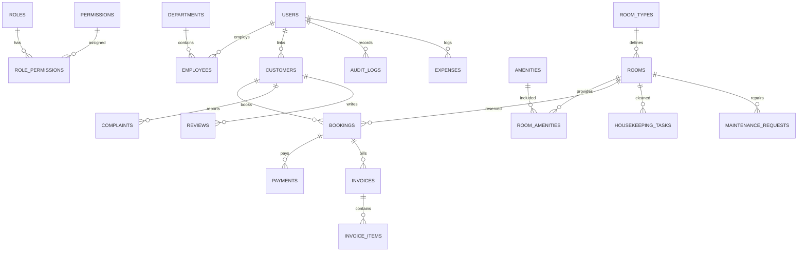

# DATABASE DOCUMENTATION & DATA DICTIONARY
# Habesha Hotel Management System (SHMS)
**Database Engine:** MySQL 8.0 / MariaDB 10.6+  
**Default Database Name:** `habesha_hotel_db`  
**Character Set:** `utf8mb4`  
**Collation:** `utf8mb4_unicode_ci`  
**Total Tables:** 27 Normalized Tables (3NF)  

---

# 1. Schema Overview

The database is designed with full relational integrity, enforcing foreign key constraints with explicit cascading delete or set null behaviors. High-frequency query columns (room statuses, booking dates, customer references, audit actions) are indexed.

---

## 2. Comprehensive Data Dictionary (27 Tables)

# 1. `roles`
Defines system access roles.
 `id` (INT, PK, AUTO_INCREMENT): Unique role identifier.
 `name` (VARCHAR(50), UNIQUE, NOT NULL): System role name (`superadmin`, `admin`, `manager`, `receptionist`, `housekeeper`, `accountant`, `maintenance`, `customer`).
 `description` (TEXT): Description of duties and privileges.
 `created_at` (DATETIME): Timestamp of role creation.

# 2. `permissions`
Granular application permissions.
 `id` (INT, PK, AUTO_INCREMENT): Unique permission identifier.
 `code` (VARCHAR(100), UNIQUE, NOT NULL): Permission code (e.g., `rooms.create`, `users.delete`).
 `description` (TEXT): Permission description.
 `module` (VARCHAR(50), NOT NULL): Module category (rooms, bookings, finance, users).

# 3. `role_permissions`
Many-to-many relationship linking roles to permissions.
 `role_id` (INT, PK, FK -> `roles.id` ON DELETE CASCADE): Target role ID.
 `permission_id` (INT, PK, FK -> `permissions.id` ON DELETE CASCADE): Target permission ID.

# 4. `users`
System user credentials and profile information.
 `id` (INT, PK, AUTO_INCREMENT): Unique user identifier.
 `email` (VARCHAR(255), UNIQUE, NOT NULL): User email address.
 `password_hash` (TEXT, NOT NULL): Salted bcrypt password hash.
 `role` (VARCHAR(50), NOT NULL, DEFAULT 'customer'): User access role.
 `full_name` (VARCHAR(255), NOT NULL): User's full name.
 `phone` (VARCHAR(50)): Contact telephone number.
 `avatar_url` (TEXT): Path or URL to profile picture.
 `is_active` (TINYINT(1), NOT NULL, DEFAULT 1): Account active status (1: Active, 0: Disabled).
 `created_at` (DATETIME): Account registration timestamp.
 `updated_at` (DATETIME): Account last update timestamp.

# 5. `departments`
Hotel functional departments.
 `id` (INT, PK, AUTO_INCREMENT): Unique department ID.
 `name` (VARCHAR(100), UNIQUE, NOT NULL): Department name (Front Desk, Housekeeping, Finance, Maintenance).
 `description` (TEXT): Department description.
 `created_at` (DATETIME): Department creation timestamp.

# 6. `employees`
Staff employment details.
 `id` (INT, PK, AUTO_INCREMENT): Unique employee ID.
 `user_id` (INT, UNIQUE, NOT NULL, FK -> `users.id` ON DELETE CASCADE): Associated user account.
 `department_id` (INT, FK -> `departments.id` ON DELETE SET NULL): Associated department.
 `employee_code` (VARCHAR(50), UNIQUE, NOT NULL): Staff employee code (e.g. `EMP-001`).
 `position` (VARCHAR(100), NOT NULL): Job title (Head Housekeeper, Chief Accountant).
 `salary` (DECIMAL(10,2), DEFAULT 0.00): Monthly salary in ETB.
 `hire_date` (DATE, NOT NULL): Employment commencement date.
 `status` (ENUM('active','on_leave','terminated'), NOT NULL, DEFAULT 'active'): Employment status.
 `created_at` (DATETIME): Record creation timestamp.

# 7. `customers`
Guest profile records.
 `id` (INT, PK, AUTO_INCREMENT): Unique customer identifier.
 `user_id` (INT, UNIQUE, FK -> `users.id` ON DELETE SET NULL): Optional linked user account.
 `full_name` (VARCHAR(255), NOT NULL): Guest's full name.
 `email` (VARCHAR(255), NOT NULL): Guest contact email.
 `phone` (VARCHAR(50)): Guest contact telephone.
 `address` (TEXT): Physical address.
 `country` (VARCHAR(100), DEFAULT 'Ethiopia'): Country of residence.
 `id_document_type` (VARCHAR(50), DEFAULT 'Passport'): Type of identification (Passport, National ID).
 `id_document_number` (VARCHAR(100)): ID or passport number.
 `preferences` (TEXT): Dietary or accommodation preferences.
 `special_requests` (TEXT): Standing requests (e.g. high floor, extra pillows).
 `created_at` (DATETIME): Registration timestamp.

# 8. `room_types`
Room category specifications.
 `id` (INT, PK, AUTO_INCREMENT): Unique room type identifier.
 `name` (VARCHAR(100), UNIQUE, NOT NULL): Room type name (Deluxe King Room, Executive Club).
 `code` (VARCHAR(20), UNIQUE, NOT NULL): Short code (e.g. `DLX-KNG`).
 `description` (TEXT, NOT NULL): Comprehensive room description.
 `base_price` (DECIMAL(10,2), NOT NULL): Standard price per night in ETB.
 `capacity` (INT, NOT NULL, DEFAULT 2): Maximum guest occupancy.
 `bed_type` (VARCHAR(50), NOT NULL): Bed configuration (King Bed, Twin Single Beds).
 `beds_count` (INT, NOT NULL, DEFAULT 1): Number of physical beds.
 `size_sqm` (INT, NOT NULL, DEFAULT 35): Room area in square meters.
 `image_url` (TEXT): Primary cover image path.
 `gallery_urls` (TEXT): JSON array of additional photo paths.
 `created_at` (DATETIME): Creation timestamp.

# 9. `rooms`
Physical hotel room inventory.
 `id` (INT, PK, AUTO_INCREMENT): Unique room ID.
 `room_number` (VARCHAR(20), UNIQUE, NOT NULL): Door room number (e.g. `101`, `204`).
 `room_type_id` (INT, NOT NULL, FK -> `room_types.id` ON DELETE RESTRICT): Associated room type.
 `floor_number` (INT, NOT NULL): Hotel floor (1 to 5).
 `status` (ENUM('available','reserved','occupied','dirty','cleaning','maintenance','out_of_service'), NOT NULL, DEFAULT 'available'): Reservation state.
 `operational_status` (ENUM('ready','needs_cleaning','cleaning_in_progress','under_repair','out_of_order'), NOT NULL, DEFAULT 'ready'): Cleanliness and physical operational readiness.
 `price_per_night` (DECIMAL(10,2), NOT NULL): Nightly rate in ETB.
 `is_active` (TINYINT(1), NOT NULL, DEFAULT 1): Active room status.
 `notes` (TEXT): Internal operational remarks.
 `created_at` (DATETIME): Room registration timestamp.

# 10. `amenities`
Catalog of hotel amenities.
 `id` (INT, PK, AUTO_INCREMENT): Unique amenity ID.
 `name` (VARCHAR(100), UNIQUE, NOT NULL): Name (High-Speed Wi-Fi, Jacuzzi, Balcony).
 `icon` (VARCHAR(50), DEFAULT 'Sparkles'): Lucide icon identifier.
 `description` (TEXT): Amenity details.
 `category` (VARCHAR(50), DEFAULT 'general'): Category (comfort, technology, luxury).

# 11. `room_amenities`
Associative table linking rooms to amenities.
 `room_id` (INT, NOT NULL, FK -> `rooms.id` ON DELETE CASCADE): Room ID.
 `amenity_id` (INT, NOT NULL, FK -> `amenities.id` ON DELETE CASCADE): Amenity ID.

# 12. `bookings`
Core reservation ledger.
 `id` (INT, PK, AUTO_INCREMENT): Unique booking ID.
 `booking_reference` (VARCHAR(50), UNIQUE, NOT NULL): Public reference code (e.g. `AG-2026-9041`).
 `customer_id` (INT, NOT NULL, FK -> `customers.id` ON DELETE RESTRICT): Associated guest.
 `room_id` (INT, NOT NULL, FK -> `rooms.id` ON DELETE RESTRICT): Assigned physical room.
 `check_in_date` (DATE, NOT NULL): Scheduled arrival date.
 `check_out_date` (DATE, NOT NULL): Scheduled departure date.
 `actual_check_in` (DATETIME): Timestamp when guest physically checked in.
 `actual_check_out` (DATETIME): Timestamp when guest physically checked out.
 `adults_count` (INT, NOT NULL, DEFAULT 1): Number of adults.
 `children_count` (INT, NOT NULL, DEFAULT 0): Number of children.
 `nights_count` (INT, NOT NULL, DEFAULT 1): Duration of stay in nights.
 `room_rate` (DECIMAL(10,2), NOT NULL): Nightly rate applied.
 `services_total` (DECIMAL(10,2), NOT NULL, DEFAULT 0.00): Total add-on service and dining charges.
 `tax_amount` (DECIMAL(10,2), NOT NULL, DEFAULT 0.00): Calculated 12% hospitality tax.
 `discount_amount` (DECIMAL(10,2), NOT NULL, DEFAULT 0.00): Promotional discount.
 `total_amount` (DECIMAL(10,2), NOT NULL): Final total cost in ETB.
 `paid_amount` (DECIMAL(10,2), NOT NULL, DEFAULT 0.00): Total payments settled.
 `status` (ENUM('pending','confirmed','checked_in','checked_out','cancelled','no_show'), NOT NULL, DEFAULT 'confirmed'): Booking operational status.
 `payment_status` (ENUM('pending','partially_paid','paid','refunded'), NOT NULL, DEFAULT 'pending'): Settlement state.
 `special_requests` (TEXT): Guest notes.
 `checked_in_by` (INT, FK -> `users.id` ON DELETE SET NULL): Receptionist ID who executed check-in.
 `checked_out_by` (INT, FK -> `users.id` ON DELETE SET NULL): Receptionist ID who executed checkout.
 `created_at` (DATETIME): Booking creation timestamp.
 `updated_at` (DATETIME): Last update timestamp.

# 13. `booking_rooms`
Allows multi-room reservations under a single booking voucher.
 `id` (INT, PK, AUTO_INCREMENT): Associative ID.
 `booking_id` (INT, NOT NULL, FK -> `bookings.id` ON DELETE CASCADE): Master booking ID.
 `room_id` (INT, NOT NULL, FK -> `rooms.id` ON DELETE RESTRICT): Associated room.
 `night_rate` (DECIMAL(10,2), NOT NULL): Nightly price.

### 14. `booking_guests`
Names and occupants staying under a single booking.
 `id` (INT, PK, AUTO_INCREMENT): Guest record ID.
 `booking_id` (INT, NOT NULL, FK -> `bookings.id` ON DELETE CASCADE): Associated booking.
 `full_name` (VARCHAR(255), NOT NULL): Guest occupant name.
 `email` (VARCHAR(255)): Guest email.
 `phone` (VARCHAR(50)): Guest phone.
 `is_primary` (TINYINT(1), NOT NULL, DEFAULT 0): 1 if primary billable guest.

# 15. `payments`
Financial transaction records.
 `id` (INT, PK, AUTO_INCREMENT): Unique payment ID.
 `booking_id` (INT, NOT NULL, FK -> `bookings.id` ON DELETE CASCADE): Associated booking.
 `payment_reference` (VARCHAR(100), UNIQUE, NOT NULL): Unique transaction reference (`PAY-YYYY-XXXX`).
 `amount` (DECIMAL(10,2), NOT NULL): Paid amount in ETB.
 `payment_method` (VARCHAR(50), NOT NULL, DEFAULT 'telebirr'): Method (`telebirr`, `cbe_birr`, `cash`, `credit_card`, `bank_transfer`).
 `status` (ENUM('pending','completed','failed','refunded'), NOT NULL, DEFAULT 'completed'): Transaction status.
 `notes` (TEXT): Transaction notes or receipt references.
 `recorded_by` (INT, FK -> `users.id` ON DELETE SET NULL): Staff cashier/receptionist ID.
 `created_at` (DATETIME): Transaction timestamp.

# 16. `invoices`
Master tax folios.
 `id` (INT, PK, AUTO_INCREMENT): Unique invoice ID.
 `invoice_number` (VARCHAR(50), UNIQUE, NOT NULL): Official invoice code (`INV-YYYY-XXXX`).
 `booking_id` (INT, UNIQUE, NOT NULL, FK -> `bookings.id` ON DELETE CASCADE): Linked booking.
 `customer_id` (INT, NOT NULL, FK -> `customers.id` ON DELETE RESTRICT): Billed customer.
 `subtotal` (DECIMAL(10,2), NOT NULL): Gross amount before taxes.
 `tax_amount` (DECIMAL(10,2), NOT NULL): 12% hospitality tax.
 `discount_amount` (DECIMAL(10,2), NOT NULL, DEFAULT 0.00): Discount deduction.
 `total_amount` (DECIMAL(10,2), NOT NULL): Net bill total in ETB.
 `paid_amount` (DECIMAL(10,2), NOT NULL, DEFAULT 0.00): Amount paid to date.
 `balance_due` (DECIMAL(10,2), NOT NULL, DEFAULT 0.00): Remaining outstanding balance.
 `status` (ENUM('unpaid','partially_paid','paid','cancelled'), NOT NULL, DEFAULT 'unpaid'): Payment status.
 `due_date` (DATE, NOT NULL): Payment due date.
 `created_at` (DATETIME): Generation timestamp.

### 17. `invoice_items`
Itemized line items contributing to an invoice.
 `id` (INT, PK, AUTO_INCREMENT): Line item ID.
 `invoice_id` (INT, NOT NULL, FK -> `invoices.id` ON DELETE CASCADE): Parent invoice.
 `description` (TEXT, NOT NULL): Line description (e.g. 3 Nights Accommodation, Doro Wat Dinner).
 `quantity` (INT, NOT NULL, DEFAULT 1): Units.
 `unit_price` (DECIMAL(10,2), NOT NULL): Rate per unit in ETB.
 `total_price` (DECIMAL(10,2), NOT NULL): Total cost.
 `item_type` (ENUM('room_charge','service','tax','discount','extra'), DEFAULT 'room_charge'): Category.

# 18. `hotel_services`
Catalog of dining and extra hotel services.
 `id` (INT, PK, AUTO_INCREMENT): Service ID.
 `name` (VARCHAR(200), NOT NULL): Service name (e.g. Special Ethiopian Kitfo with Ayib).
 `category` (ENUM('dining','spa','transport','laundry','conference','room_service','other'), NOT NULL): Service category.
 `price` (DECIMAL(10,2), NOT NULL): Price in ETB.
 `description` (TEXT): Detailed description.
 `icon` (VARCHAR(50), DEFAULT 'Coffee'): Lucide icon name.
 `is_available` (TINYINT(1), NOT NULL, DEFAULT 1): Operational availability (1: Available, 0: Out of Stock).
 `created_at` (DATETIME): Creation timestamp.

# 19. `service_orders`
Guest orders for extra services or room dining.
 `id` (INT, PK, AUTO_INCREMENT): Order ID.
 `booking_id` (INT, NOT NULL, FK -> `bookings.id` ON DELETE CASCADE): Guest stay ID.
 `service_id` (INT, NOT NULL, FK -> `hotel_services.id` ON DELETE RESTRICT): Ordered service.
 `quantity` (INT, NOT NULL, DEFAULT 1): Quantity.
 `unit_price` (DECIMAL(10,2), NOT NULL): Unit price.
 `total_price` (DECIMAL(10,2), NOT NULL): Total cost.
 `status` (ENUM('pending','in_progress','completed','cancelled'), NOT NULL, DEFAULT 'pending'): Order state.
 `order_time` (DATETIME, DEFAULT CURRENT_TIMESTAMP): Order timestamp.
 `delivered_time` (DATETIME): Delivery timestamp.
 `notes` (TEXT): Special cooking or delivery instructions.
 `ordered_by` (INT, FK -> `users.id` ON DELETE SET NULL): Ordering user ID.

### 20. `housekeeping_tasks`
Room cleaning and turnover tasks.
 `id` (INT, PK, AUTO_INCREMENT): Task ID.
 `room_id` (INT, NOT NULL, FK -> `rooms.id` ON DELETE CASCADE): Room requiring cleaning.
 `assigned_employee_id` (INT, FK -> `employees.id` ON DELETE SET NULL): Assigned housekeeper.
 `task_type` (ENUM('standard_clean','deep_clean','turn_down','inspection','sanitization'), NOT NULL, DEFAULT 'standard_clean'): Task scope.
 `priority` (ENUM('low','medium','high','urgent'), NOT NULL, DEFAULT 'medium'): Priority urgency.
 `status` (ENUM('pending','in_progress','completed','verified'), NOT NULL, DEFAULT 'pending'): Turnover status.
 `instructions` (TEXT): Special cleaning instructions.
 `scheduled_for` (DATE): Target date.
 `started_at` (DATETIME): Timestamp when housekeeper initiated cleaning.
 `completed_at` (DATETIME): Timestamp when housekeeper completed cleaning.
 `created_at` (DATETIME): Task creation timestamp.

# 21. `maintenance_requests`
Engineering repair tickets and equipment defects.
 `id` (INT, PK, AUTO_INCREMENT): Maintenance request ID.
 `room_id` (INT, NOT NULL, FK -> `rooms.id` ON DELETE CASCADE): Affected room.
 `reported_by` (INT, NOT NULL, FK -> `users.id` ON DELETE RESTRICT): Staff member reporting the issue.
 `technician_id` (INT, FK -> `employees.id` ON DELETE SET NULL): Assigned technician.
 `issue_title` (VARCHAR(255), NOT NULL): Summary of defect (e.g. AC cooling malfunction).
 `description` (TEXT, NOT NULL): Detailed problem description.
 `priority` (ENUM('low','medium','high','critical'), NOT NULL, DEFAULT 'medium'): Defect severity.
 `status` (ENUM('reported','in_progress','resolved','cancelled'), NOT NULL, DEFAULT 'reported'): Repair progress.
 `estimated_cost` (DECIMAL(10,2), DEFAULT 0.00): Estimated parts and labor in ETB.
 `actual_cost` (DECIMAL(10,2), DEFAULT 0.00): Actual repair cost incurred.
 `reported_at` (DATETIME, DEFAULT CURRENT_TIMESTAMP): Reporting timestamp.
 `resolved_at` (DATETIME): Completion timestamp.
 `resolution_notes` (TEXT): Technician notes on parts replaced and verification.

# 22. `reviews`
Verified guest reviews and ratings.
 `id` (INT, PK, AUTO_INCREMENT): Review ID.
 `customer_id` (INT, NOT NULL, FK -> `customers.id` ON DELETE CASCADE): Reviewing customer.
 `booking_id` (INT, FK -> `bookings.id` ON DELETE SET NULL): Associated verified stay.
 `room_type_id` (INT, FK -> `room_types.id` ON DELETE SET NULL): Reviewed room type.
 `rating` (INT, NOT NULL): Star rating (1 to 5).
 `title` (VARCHAR(255), NOT NULL): Review headline.
 `comment` (TEXT, NOT NULL): Full guest testimonial.
 `is_approved` (TINYINT(1), NOT NULL, DEFAULT 1): Moderation status (1: Visible, 0: Hidden).
 `created_at` (DATETIME): Submission timestamp.

# 23. `notifications`
In-app notification system.
 `id` (INT, PK, AUTO_INCREMENT): Notification ID.
 `user_id` (INT, NOT NULL, FK -> `users.id` ON DELETE CASCADE): Target user.
 `title` (VARCHAR(255), NOT NULL): Notification headline.
 `message` (TEXT, NOT NULL): Detailed message.
 `type` (ENUM('info','success','warning','urgent'), NOT NULL, DEFAULT 'info'): Severity.
 `is_read` (TINYINT(1), NOT NULL, DEFAULT 0): Read flag (0: Unread, 1: Read).
 `link_url` (VARCHAR(255)): Optional deep link URL.
 `created_at` (DATETIME): Creation timestamp.

# 24. `complaints`
Guest complaint recovery tickets.
 `id` (INT, PK, AUTO_INCREMENT): Complaint ID.
 `customer_id` (INT, NOT NULL, FK -> `customers.id` ON DELETE CASCADE): Complaining customer.
 `booking_id` (INT, FK -> `bookings.id` ON DELETE SET NULL): Associated booking.
 `title` (VARCHAR(255), NOT NULL): Complaint summary.
 `description` (TEXT, NOT NULL): Full description of dissatisfaction.
 `department_id` (INT, FK -> `departments.id` ON DELETE SET NULL): Responsible department.
 `priority` (ENUM('low','medium','high','critical'), NOT NULL, DEFAULT 'medium'): Severity.
 `status` (ENUM('open','under_investigation','resolved','closed'), NOT NULL, DEFAULT 'open'): Progress state.
 `resolution_notes` (TEXT): Service recovery notes and corrective actions.
 `resolved_by` (INT, FK -> `users.id` ON DELETE SET NULL): Manager who approved resolution.
 `created_at` (DATETIME): Incident report timestamp.
 `resolved_at` (DATETIME): Resolution timestamp.

### 25. `audit_logs`
Immutable forensic system audit ledger.
 `id` (INT, PK, AUTO_INCREMENT): Audit record ID.
 `user_id` (INT, FK -> `users.id` ON DELETE SET NULL): Actor user ID.
 `user_role` (VARCHAR(50)): Role of actor at the time of execution.
 `action` (VARCHAR(100), NOT NULL): Action code (e.g. `USER_LOGIN`, `GUEST_CHECK_IN`, `ROOM_STATUS_CHANGE`).
 `entity_type` (VARCHAR(100), NOT NULL): Affected entity (`bookings`, `rooms`, `users`, `invoices`).
 `entity_id` (INT): Primary key of affected entity.
 `details` (TEXT): Human-readable activity description.
 `ip_address` (VARCHAR(50)): Client IPv4 or IPv6 address.
 `status` (VARCHAR(50), DEFAULT 'success'): Execution status (`success`, `failed`, `denied`).
 `created_at` (DATETIME, DEFAULT CURRENT_TIMESTAMP): Tamper-proof timestamp.

### 26. `hotel_settings`
Global system configuration key-value store.
 `id` (INT, PK, AUTO_INCREMENT): Setting ID.
 `key` (VARCHAR(100), UNIQUE, NOT NULL): Configuration key (e.g. `tax_rate`, `currency_symbol`, `hotel_phone`).
 `value` (TEXT, NOT NULL): Stored configuration value (e.g. `12.0`, `ETB`, `+251 11 667 8000`).
 `label` (VARCHAR(100), NOT NULL): UI label for settings form.
 `category` (VARCHAR(50), NOT NULL, DEFAULT 'general'): Settings group.
 `updated_at` (DATETIME): Last modification timestamp.

### 27. `expenses`
Operational expense tracking ledger for accountants.
 `id` (INT, PK, AUTO_INCREMENT): Expense record ID.
 `category` (VARCHAR(100), NOT NULL): Expense category (`utilities`, `food_beverage`, `supplies`, `maintenance`).
 `title` (VARCHAR(255), NOT NULL): Expense title (e.g. Ethiopian Electric Power - Bole Substation).
 `amount` (DECIMAL(10,2), NOT NULL): Expense amount in ETB.
 `currency` (VARCHAR(10), DEFAULT 'ETB'): Currency code.
 `payment_method` (VARCHAR(50), DEFAULT 'bank_transfer'): Disbursement method (`bank_transfer`, `telebirr`, `cbe_birr`, `cash`).
 `reference_number` (VARCHAR(100)): Bank transaction reference code.
 `expense_date` (DATE, NOT NULL): Disbursement date.
 `recorded_by` (INT, FK -> `users.id` ON DELETE SET NULL): Accountant ID who logged the expense.
 `notes` (TEXT): Descriptive remarks and vendor information.
 `created_at` (DATETIME): Record creation timestamp.

