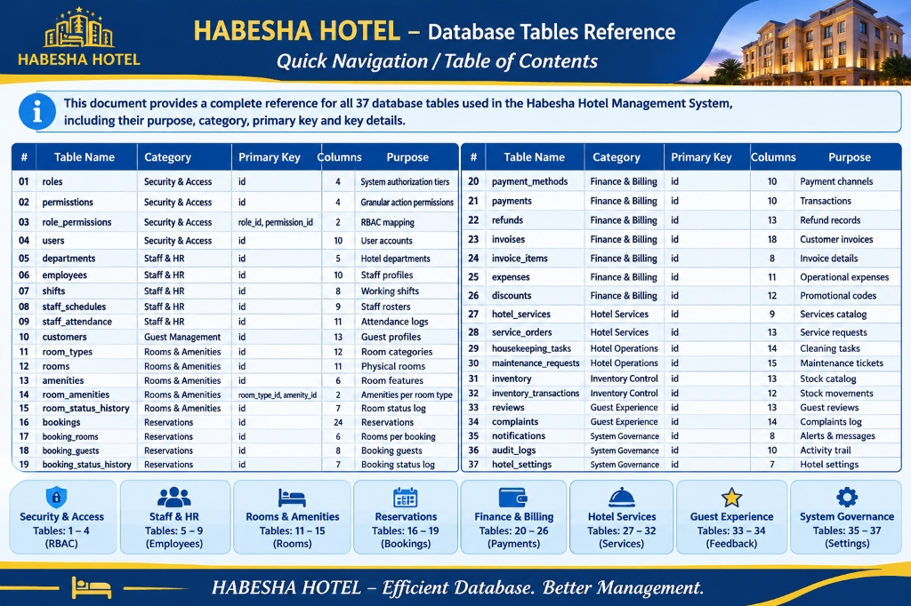

# HABESHA HOTEL MANAGEMENT SYSTEM (SHMS)
# Master Database Table & Column Reference (37 Tables)

**Engine:** MySQL 8.0+ / InnoDB (ACID Compliant)  
**Total Tables:** 37 Normalized Tables (3NF)  
**Total Columns:** 356 Attributes  
**Architecture:** Relational RBAC with Financial & Operational Subsystems  
**Currency Standard:** Ethiopian Birr (ETB) with Multi-Currency Support  

---

---

## Quick Navigation / Table of Contents

| # | Table Name | Category | Primary Key | Columns | Purpose |
|:---|:---|:---|:---|:---:|:---|
| **01** | [`roles`](#01-roles) | Security & Access | `id` | 4 | System authorization tiers |
| **02** | [`permissions`](#02-permissions) | Security & Access | `id` | 4 | Granular action permissions |
| **03** | [`role_permissions`](#03-role_permissions) | Security & Access | `role_id, permission_id` | 2 | RBAC role-to-permission mapping |
| **04** | [`users`](#04-users) | Security & Access | `id` | 10 | Central user authentication accounts |
| **05** | [`departments`](#05-departments) | Staff & HR | `id` | 5 | Hotel operational departments |
| **06** | [`employees`](#06-employees) | Staff & HR | `id` | 10 | Staff employment profiles & records |
| **07** | [`shifts`](#07-shifts) | Staff & HR | `id` | 8 | Operational working shifts |
| **08** | [`staff_schedules`](#08-staff_schedules) | Staff & HR | `id` | 9 | Weekly employee shift rosters |
| **09** | [`staff_attendance`](#09-staff_attendance) | Staff & HR | `id` | 11 | Clock-in/out and timesheet logs |
| **10** | [`customers`](#10-customers) | Guest Management | `id` | 13 | Registered hotel guest profiles |
| **11** | [`room_types`](#11-room_types) | Rooms & Amenities | `id` | 12 | Room categories, rates & capacities |
| **12** | [`rooms`](#12-rooms) | Rooms & Amenities | `id` | 11 | Physical rooms & operational status |
| **13** | [`amenities`](#13-amenities) | Rooms & Amenities | `id` | 6 | Available room features & facilities |
| **14** | [`room_amenities`](#14-room_amenities) | Rooms & Amenities | `room_type_id, amenity_id` | 2 | Room type amenity assignments |
| **15** | [`room_status_history`](#15-room_status_history) | Rooms & Amenities | `id` | 7 | Audit trail for room condition changes |
| **16** | [`bookings`](#16-bookings) | Reservations | `id` | 24 | Guest reservation master records |
| **17** | [`booking_rooms`](#17-booking_rooms) | Reservations | `id` | 6 | Multi-room booking assignments |
| **18** | [`booking_guests`](#18-booking_guests) | Reservations | `id` | 8 | Manifest of staying guest occupants |
| **19** | [`booking_status_history`](#19-booking_status_history) | Reservations | `id` | 7 | Reservation state progression log |
| **20** | [`payment_methods`](#20-payment_methods) | Finance & Billing | `id` | 10 | Supported payment channels (Telebirr, CBE) |
| **21** | [`payments`](#21-payments) | Finance & Billing | `id` | 10 | Financial transactions & receipts |
| **22** | [`refunds`](#22-refunds) | Finance & Billing | `id` | 13 | Cancellation & customer refund ledger |
| **23** | [`invoices`](#23-invoices) | Finance & Billing | `id` | 18 | Official customer billing invoices |
| **24** | [`invoice_items`](#24-invoice_items) | Finance & Billing | `id` | 8 | Line-item details of billed charges |
| **25** | [`expenses`](#25-expenses) | Finance & Billing | `id` | 11 | Hotel operational expense tracker |
| **26** | [`discounts`](#26-discounts) | Finance & Billing | `id` | 12 | Promotional codes & seasonal vouchers |
| **27** | [`hotel_services`](#27-hotel_services) | Hotel Services | `id` | 9 | Catalog of guest amenities & dining |
| **28** | [`service_orders`](#28-service_orders) | Hotel Services | `id` | 13 | In-room dining & service requests |
| **29** | [`housekeeping_tasks`](#29-housekeeping_tasks) | Hotel Operations | `id` | 14 | Room cleaning, inspection & turndown |
| **30** | [`maintenance_requests`](#30-maintenance_requests) | Hotel Operations | `id` | 15 | Facility repair tickets & work orders |
| **31** | [`inventory`](#31-inventory) | Inventory Control | `id` | 13 | Stock catalog, linen & supplies |
| **32** | [`inventory_transactions`](#32-inventory_transactions) | Inventory Control | `id` | 12 | Stock movements (in/out/loss/audit) |
| **33** | [`reviews`](#33-reviews) | Guest Experience | `id` | 13 | Guest ratings, feedback & management responses |
| **34** | [`complaints`](#34-complaints) | Guest Experience | `id` | 14 | Guest grievances & resolution tracking |
| **35** | [`notifications`](#35-notifications) | System Governance | `id` | 8 | User alert dispatch feed |
| **36** | [`audit_logs`](#36-audit_logs) | System Governance | `id` | 10 | Security compliance & activity trail |
| **37** | [`hotel_settings`](#37-hotel_settings) | System Governance | `id` | 7 | Dynamic hotel metadata & configurations |

---

## Module 1: Core Security & Access Control (RBAC)

### 01. `roles`

> 🎯 **Purpose:** Defines the 7 distinct system authorization tiers governing user capabilities across the entire hotel management platform.  
> 🔗 **Relationships:** Referenced by `role_permissions.role_id` and `users.role`.

| Column Name | Data Type | Null | Default | Key / Constraints | Description & Business Rules |
|:---|:---|:---:|:---:|:---|:---|
| **`id`** | INT | NO | None | **PK** (AUTO_INCREMENT) | Unique surrogate role identifier |
| **`name`** | VARCHAR(50) | NO | None | UNIQUE | Role code: `superadmin`, `admin`, `manager`, `receptionist`, `accountant`, `housekeeper`, `customer` |
| **`description`** | TEXT | YES | NULL | - | Clear description of responsibilities and scope of access |
| **`created_at`** | DATETIME | YES | CURRENT_TIMESTAMP | - | Timestamp when the role definition was created |

#### 🗄️ Sample Data
| id | name | description | created_at |
|:---:|:---|:---|:---|
| 1 | superadmin | Full access to all features and settings | 2025-01-01 10:00:00 |
| 2 | admin | Manage hotel system and users | 2025-01-01 10:05:00 |
| 3 | manager | Manage daily operations | 2025-01-01 10:10:00 |
| 4 | receptionist | Handle reservations and guests | 2025-01-01 10:15:00 |
| 5 | accountant | Manage financial records | 2025-01-01 10:20:00 |
| 6 | housekeeper | Manage room cleaning | 2025-01-01 10:25:00 |
| 7 | customer | Book rooms and view services | 2025-01-01 10:30:00 |

---

### 02. `permissions`

> 🎯 **Purpose:** Contains atomic system privileges (actions) that can be granted to roles across hotel management modules.  
> 🔗 **Relationships:** Referenced by `role_permissions.permission_id`.

| Column Name | Data Type | Null | Default | Key / Constraints | Description & Business Rules |
|:---|:---|:---:|:---:|:---|:---|
| **`id`** | INT | NO | None | **PK** (AUTO_INCREMENT) | Unique surrogate permission identifier |
| **`code`** | VARCHAR(100) | NO | None | UNIQUE | Distinct privilege key (e.g. `users.manage`, `rooms.manage`, `bookings.manage`) |
| **`description`** | TEXT | YES | NULL | - | Explanation of what actions this permission permits |
| **`module`** | VARCHAR(50) | NO | None | - | Application subsystem grouping (`users`, `rooms`, `bookings`, `frontdesk`, `finance`, `housekeeping`, `reports`, `settings`) |

#### 🗄️ Sample Data
| id | code | description | module |
|:---:|:---|:---|:---|
| 1 | users.manage | Create and modify users and roles | users |
| 2 | rooms.manage | Configure room types, rooms and pricing | rooms |
| 3 | bookings.manage | Create, update, cancel reservations | bookings |
| 4 | checkin.process | Execute guest check-in and check-out | frontdesk |
| 5 | finance.manage | Process payments and manage invoices | finance |
| 6 | housekeeping.manage | Assign and update room cleaning tasks | housekeeping |
| 7 | reports.view | Generate business and occupancy reports | reports |
| 8 | settings.manage | Configure hotel policies and taxes | settings |

---

### 03. `role_permissions`

> 🎯 **Purpose:** Composite junction table establishing a Many-to-Many relationship between `roles` and `permissions`.  
> 🔗 **Relationships:** Composite PK of `role_id` → `roles.id` and `permission_id` → `permissions.id`.

| Column Name | Data Type | Null | Default | Key / Constraints | Description & Business Rules |
|:---|:---|:---:|:---:|:---|:---|
| **`role_id`** | INT | NO | None | **PK**, **FK** → `roles.id` | Target role ID (ON DELETE CASCADE) |
| **`permission_id`** | INT | NO | None | **PK**, **FK** → `permissions.id` | Target permission ID (ON DELETE CASCADE) |

#### 🗄️ Sample Data
| role_id | permission_id | Role Granted | Permission Key | Scope of Authorization |
|:---:|:---:|:---|:---|:---|
| 1 | 1 | superadmin | users.manage | Full control over users and security |
| 1 | 2 | superadmin | rooms.manage | Full control over inventory & rates |
| 1 | 3 | superadmin | bookings.manage | Master reservation governance |
| 1 | 5 | superadmin | finance.manage | Master ledger and payment control |
| 2 | 1 | admin | users.manage | Staff administration |
| 3 | 2 | manager | rooms.manage | Operational room assignment |
| 3 | 3 | manager | bookings.manage | Reservation management |
| 4 | 3 | receptionist | bookings.manage | Guest booking front desk ops |
| 4 | 4 | receptionist | checkin.process | Check-in / check-out processing |
| 5 | 5 | accountant | finance.manage | Invoicing, payments & ledger |
| 6 | 6 | housekeeper | housekeeping.manage | Task progress & cleaning status |
| 7 | 3 | customer | bookings.manage | Personal stay booking & review |

---

### 04. `users`

> 🎯 **Purpose:** Central authentication registry storing login credentials, cryptographic password hashes, and profile metadata.  
> 🔗 **Relationships:** Referenced by `employees.user_id`, `customers.user_id`, `audit_logs.user_id`, `notifications.user_id`.

| Column Name | Data Type | Null | Default | Key / Constraints | Description & Business Rules |
|:---|:---|:---:|:---:|:---|:---|
| **`id`** | INT | NO | None | **PK** (AUTO_INCREMENT) | Unique user identification number |
| **`email`** | VARCHAR(255) | NO | None | UNIQUE | Login username / primary email address |
| **`password_hash`** | TEXT | NO | None | - | Secure 60-character Bcrypt salted cryptographic password hash |
| **`role`** | VARCHAR(50) | NO | 'customer' | INDEX | User role tier matching `roles.name` |
| **`full_name`** | VARCHAR(255) | NO | None | - | Legal full name in Latin alphabet |
| **`phone`** | VARCHAR(50) | YES | NULL | - | Contact telephone number (e.g. +251 91 123 4567) |
| **`avatar_url`** | TEXT | YES | NULL | - | Path to uploaded user avatar in `/images/staff/` or `/images/guests/` |
| **`is_active`** | TINYINT(1) | NO | 1 | - | Account access switch (1 = Active, 0 = Suspended / Deactivated) |
| **`created_at`** | DATETIME | YES | CURRENT_TIMESTAMP | - | User registration date and time |
| **`updated_at`** | DATETIME | YES | CURRENT_TIMESTAMP ON UPDATE | - | Timestamp of last profile or security credential update |

#### 🗄️ Sample Data
| id | email | role | full_name | phone | avatar_url | is_active |
|:---:|:---|:---|:---|:---|:---|:---:|
| 1 | superadmin@habeshahotel.com | superadmin | Dawit Hailemariam | +251 91 000 1122 | /images/staff/dawit-manager.jpg | 1 |
| 2 | admin@habeshahotel.com | admin | Selam Tesfaye | +251 91 123 4567 | /images/staff/selam-tesfaye.png | 1 |
| 3 | manager@habeshahotel.com | manager | Bilal Ahmed | +251 91 234 5678 | /images/staff/bilal.webp | 1 |
| 4 | reception@habeshahotel.com | receptionist | Firdews Mohammed | +251 91 345 6789 | /images/staff/firdews.jpg | 1 |
| 5 | accountant@habeshahotel.com | accountant | Mahlet Kebede | +251 91 999 8877 | /images/staff/Mahlet Kebede.jpg | 1 |
| 6 | housekeeping@habeshahotel.com | housekeeper | Hiwot Tadesse | +251 91 456 7890 | /images/staff/hiwot-housekeeper.jpg | 1 |
| 7 | guest@habeshahotel.com | customer | Murad Kassim | +251 91 789 0123 | /images/guests/murad.jpg | 1 |

---

## Module 2: Staff & Human Resources Operations

### 05. `departments`

> 📌 **Purpose:** Represents organizational hotel divisions (Executive, Front Desk, Housekeeping, Maintenance, F&B).  
> 🔗 **Relationships:** Referenced by `employees.department_id` and `staff_schedules.department_id`.

| Column Name | Data Type | Null | Default | Key / Constraints | Description & Business Rules |
|:---|:---|:---:|:---:|:---|:---|
| **`id`** | INT | NO | None | **PK** (AUTO_INCREMENT) | Unique department identifier |
| **`name`** | VARCHAR(100) | NO | None | UNIQUE | Department title (e.g. Executive Management, Front Desk & Concierge) |
| **`description`** | TEXT | YES | NULL | None | Department duties and operational scope |
| **`created_at`** | DATETIME | YES | CURRENT_TIMESTAMP | None | Record creation date |
| **`updated_at`** | DATETIME | YES | CURRENT_TIMESTAMP ON UPDATE | None | Record update timestamp |

---

### 06. `employees`

> 📌 **Purpose:** Detailed staff HR profiles linked to their user login accounts, storing salary, job code, and hire dates.  
> 🔗 **Relationships:** References `users.id` (CASCADE) and `departments.id` (SET NULL). Referenced by housekeeping, maintenance, and schedules.

| Column Name | Data Type | Null | Default | Key / Constraints | Description & Business Rules |
|:---|:---|:---:|:---:|:---|:---|
| **`id`** | INT | NO | None | **PK** (AUTO_INCREMENT) | Unique employee internal record ID |
| **`user_id`** | INT | NO | None | **FK** → `users.id`, UNIQUE | Foreign key to the staff member's user login record |
| **`department_id`** | INT | YES | NULL | **FK** → `departments.id` | Assigned hotel department (ON DELETE SET NULL) |
| **`employee_code`** | VARCHAR(50) | NO | None | UNIQUE | Official employee ID badge number (e.g. `EMP-001`) |
| **`position`** | VARCHAR(100) | NO | None | None | Job title (e.g. Lead Housekeeping Supervisor, Systems Engineer) |
| **`salary`** | DECIMAL(10,2) | YES | 0.00 | None | Monthly compensation in ETB |
| **`hire_date`** | DATE | NO | None | None | Date employment commenced |
| **`status`** | ENUM(...) | NO | 'active' | ENUM | Status: `active`, `on_leave`, `terminated` |
| **`created_at`** | DATETIME | YES | CURRENT_TIMESTAMP | None | Profile registration timestamp |
| **`updated_at`** | DATETIME | YES | CURRENT_TIMESTAMP ON UPDATE | None | Profile update timestamp |

---

### 07. `shifts`

> 📌 **Purpose:** Configures daily operational work shifts (Morning, Evening, Night) with standard start and end hours.  
> 🔗 **Relationships:** Referenced by `staff_schedules.shift_id` and `staff_attendance.shift_id`.

| Column Name | Data Type | Null | Default | Key / Constraints | Description & Business Rules |
|:---|:---|:---:|:---:|:---|:---|
| **`id`** | INT | NO | None | **PK** (AUTO_INCREMENT) | Unique shift identifier |
| **`name`** | VARCHAR(50) | NO | None | None | Descriptive shift name (e.g. Morning Shift, Night Shift) |
| **`code`** | VARCHAR(20) | NO | None | UNIQUE | Short code (e.g. `MORNING`, `EVENING`, `NIGHT`) |
| **`start_time`** | TIME | NO | None | None | Official shift start time (e.g. 07:00:00) |
| **`end_time`** | TIME | NO | None | None | Official shift end time (e.g. 15:30:00) |
| **`description`** | TEXT | YES | NULL | None | Specific duties expected during this shift |
| **`created_at`** | DATETIME | YES | CURRENT_TIMESTAMP | None | Record creation timestamp |
| **`updated_at`** | DATETIME | YES | CURRENT_TIMESTAMP ON UPDATE | None | Record update timestamp |

---

### 08. `staff_schedules`

> 📌 **Purpose:** Weekly duty rosters scheduling staff members for shifts and specific dates.  
> 🔗 **Relationships:** References `employees.id`, `shifts.id`, and `departments.id`.

| Column Name | Data Type | Null | Default | Key / Constraints | Description & Business Rules |
|:---|:---|:---:|:---|:---|:---|
| **`id`** | INT | NO | None | **PK** (AUTO_INCREMENT) | Unique schedule entry ID |
| **`employee_id`** | INT | NO | None | **FK** → `employees.id` | Scheduled staff member (ON DELETE CASCADE) |
| **`shift_id`** | INT | NO | None | **FK** → `shifts.id` | Assigned work shift (ON DELETE RESTRICT) |
| **`department_id`** | INT | YES | NULL | **FK** → `departments.id` | Department where shift will be performed |
| **`work_date`** | DATE | NO | None | INDEX | Scheduled calendar workday |
| **`status`** | ENUM(...) | NO | 'scheduled' | ENUM | Roster state: `scheduled`, `completed`, `absent`, `cancelled` |
| **`notes`** | TEXT | YES | NULL | None | Manager schedule notes or swap remarks |
| **`created_at`** | DATETIME | YES | CURRENT_TIMESTAMP | None | Creation timestamp |
| **`updated_at`** | DATETIME | YES | CURRENT_TIMESTAMP ON UPDATE | None | Update timestamp |

---

### 09. `staff_attendance`

> 📌 **Purpose:** Electronic timecard logs tracking actual staff clock-in/out timestamps, total hours worked, and punctuality.  
> 🔗 **Relationships:** References `employees.id` and `shifts.id`.

| Column Name | Data Type | Null | Default | Key / Constraints | Description & Business Rules |
|:---|:---|:---:|:---:|:---|:---|
| **`id`** | INT | NO | None | **PK** (AUTO_INCREMENT) | Unique attendance punch ID |
| **`employee_id`** | INT | NO | None | **FK** → `employees.id` | Staff member logging attendance |
| **`shift_id`** | INT | YES | NULL | **FK** → `shifts.id` | Matched scheduled shift |
| **`date`** | DATE | NO | None | INDEX | Attendance calendar date |
| **`clock_in`** | DATETIME | YES | NULL | None | Actual biometric or front desk check-in time |
| **`clock_out`** | DATETIME | YES | NULL | None | Actual check-out time |
| **`status`** | ENUM(...) | NO | 'present' | ENUM | State: `present`, `absent`, `late`, `half_day`, `on_leave` |
| **`total_hours`** | DECIMAL(5,2) | YES | 0.00 | None | Calculated duration in decimal hours (e.g. 8.50) |
| **`notes`** | TEXT | YES | NULL | None | Supervisor exception notes (e.g. 'Approved early departure') |
| **`created_at`** | DATETIME | YES | CURRENT_TIMESTAMP | None | Record creation timestamp |
| **`updated_at`** | DATETIME | YES | CURRENT_TIMESTAMP ON UPDATE | None | Record update timestamp |

---

## Module 3: Guest Management

### 10. `customers`

> 📌 **Purpose:** Master guest profiles containing contact info, national ID / passport numbers, preferences, and visit notes.  
> 🔗 **Relationships:** References `users.id` (optional for walk-ins). Referenced by `bookings.customer_id` and `invoices.customer_id`.

| Column Name | Data Type | Null | Default | Key / Constraints | Description & Business Rules |
|:---|:---|:---:|:---:|:---|:---|
| **`id`** | INT | NO | None | **PK** (AUTO_INCREMENT) | Unique customer ID |
| **`user_id`** | INT | YES | NULL | **FK** → `users.id`, UNIQUE | Linked user login (NULL for walk-in desk registrations) |
| **`full_name`** | VARCHAR(255) | NO | None | INDEX | Guest full legal name as shown on passport or National ID |
| **`email`** | VARCHAR(255) | YES | NULL | None | Primary communication email |
| **`phone`** | VARCHAR(50) | NO | None | None | Mobile phone number for booking confirmation SMS |
| **`address`** | TEXT | YES | NULL | None | Residence address or city of origin |
| **`country`** | VARCHAR(100) | YES | 'Ethiopia' | None | Nationality / home country |
| **`id_type`** | VARCHAR(50) | YES | NULL | None | Document type: `Passport`, `National ID`, `Driver License` |
| **`id_number`** | VARCHAR(100) | YES | NULL | None | Document serial number for legal hotel compliance |
| **`preferences`** | TEXT | YES | NULL | None | Guest stay preferences (e.g. High floor, extra pillows, quiet room) |
| **`notes`** | TEXT | YES | NULL | None | Front desk concierge notes (e.g. 'VIP AU delegate') |
| **`created_at`** | DATETIME | YES | CURRENT_TIMESTAMP | None | Profile creation timestamp |
| **`updated_at`** | DATETIME | YES | CURRENT_TIMESTAMP ON UPDATE | None | Profile update timestamp |

---

## Module 4: Rooms, Amenities & Physical Inventory

### 11. `room_types`

> 📌 **Purpose:** Defines room categories (Deluxe King, Executive Suite, Family Suite), base pricing, and maximum guest capacities.  
> 🔗 **Relationships:** Referenced by `rooms.room_type_id` and `room_amenities.room_type_id`.

| Column Name | Data Type | Null | Default | Key / Constraints | Description & Business Rules |
|:---|:---|:---:|:---:|:---|:---|
| **`id`** | INT | NO | None | **PK** (AUTO_INCREMENT) | Unique room type ID |
| **`name`** | VARCHAR(100) | NO | None | UNIQUE | Type name (e.g. Standard Single, Presidential Sovereign Suite) |
| **`description`** | TEXT | YES | NULL | None | Marketing and architectural description of the room |
| **`base_price`** | DECIMAL(10,2) | NO | None | None | Standard night tariff in ETB |
| **`capacity_adults`** | INT | NO | 2 | None | Maximum adult occupants permitted |
| **`capacity_children`**| INT | NO | 0 | None | Maximum child occupants permitted |
| **`total_rooms`** | INT | NO | 0 | None | Count of physical rooms configured under this type |
| **`size_sqm`** | INT | YES | NULL | None | Floor area in square meters |
| **`bed_type`** | VARCHAR(50) | YES | NULL | None | Bed layout (e.g. King, Twin Beds, Queen) |
| **`image_url`** | TEXT | YES | NULL | None | Showcase image path in `/images/rooms/` |
| **`created_at`** | DATETIME | YES | CURRENT_TIMESTAMP | None | Record creation timestamp |
| **`updated_at`** | DATETIME | YES | CURRENT_TIMESTAMP ON UPDATE | None | Record update timestamp |

---

### 12. `rooms`

> 📌 **Purpose:** Represents every physical hotel room, tracking floor location, booking availability, and housekeeping status.  
> 🔗 **Relationships:** References `room_types.id`. Referenced by `bookings.room_id`, `housekeeping_tasks.room_id`, `maintenance_requests.room_id`.

| Column Name | Data Type | Null | Default | Key / Constraints | Description & Business Rules |
|:---|:---|:---:|:---:|:---|:---|
| **`id`** | INT | NO | None | **PK** (AUTO_INCREMENT) | Unique room ID |
| **`room_number`** | VARCHAR(20) | NO | None | UNIQUE | Physical door number (e.g. `101`, `205`, `501`) |
| **`room_type_id`** | INT | NO | None | **FK** → `room_types.id` | Category archetype (ON DELETE RESTRICT) |
| **`floor_number`** | INT | NO | None | None | Building floor level (1 to 5) |
| **`status`** | ENUM(...) | NO | 'available' | INDEX | Guest status: `available`, `reserved`, `occupied`, `dirty`, `cleaning`, `maintenance`, `out_of_service` |
| **`operational_status`**| ENUM(...) | NO | 'ready' | None | Housekeeping readiness: `ready`, `needs_cleaning`, `cleaning_in_progress`, `under_repair`, `out_of_order` |
| **`price_per_night`** | DECIMAL(10,2) | NO | None | None | Active nightly room charge in ETB |
| **`is_active`** | TINYINT(1) | NO | 1 | None | 1 = In inventory, 0 = Decommissioned / permanently disabled |
| **`notes`** | TEXT | YES | NULL | None | Physical features (e.g. 'Balcony facing Africa Avenue') |
| **`created_at`** | DATETIME | YES | CURRENT_TIMESTAMP | None | Room registration timestamp |
| **`updated_at`** | DATETIME | YES | CURRENT_TIMESTAMP ON UPDATE | None | Status update timestamp |

---

### 13. `amenities`

> 📌 **Purpose:** Catalog of in-room and hotel facilities (Fast Wi-Fi, Balcony, Minibar, Steam Shower, Smart TV).  
> 🔗 **Relationships:** Referenced by `room_amenities.amenity_id`.

| Column Name | Data Type | Null | Default | Key / Constraints | Description & Business Rules |
|:---|:---|:---:|:---:|:---|:---|
| **`id`** | INT | NO | None | **PK** (AUTO_INCREMENT) | Unique amenity ID |
| **`name`** | VARCHAR(100) | NO | None | UNIQUE | Amenity name (e.g. High-Speed Fiber Wi-Fi, Coffee Maker) |
| **`icon`** | VARCHAR(50) | YES | NULL | None | Lucide icon identifier (e.g. `Wifi`, `Coffee`, `Tv`) |
| **`description`** | TEXT | YES | NULL | None | Description of the feature |
| **`category`** | VARCHAR(50) | YES | 'general' | None | Grouping: `general`, `bathroom`, `technology`, `wellness` |
| **`created_at`** | DATETIME | YES | CURRENT_TIMESTAMP | None | Creation timestamp |

---

### 14. `room_amenities`

> 📌 **Purpose:** Junction table linking `room_types` to the specific `amenities` included in that category.  
> 🔗 **Relationships:** Composite PK of `room_type_id` → `room_types.id` and `amenity_id` → `amenities.id`.

| Column Name | Data Type | Null | Default | Key / Constraints | Description & Business Rules |
|:---|:---|:---:|:---:|:---|:---|
| **`room_type_id`** | INT | NO | None | **PK**, **FK** → `room_types.id` | Target room type (ON DELETE CASCADE) |
| **`amenity_id`** | INT | NO | None | **PK**, **FK** → `amenities.id` | Included amenity (ON DELETE CASCADE) |

---

### 15. `room_status_history`

> 📌 **Purpose:** Audit log recording every state transition of a room (e.g. `dirty` → `cleaning` → `ready`), who changed it, and why.  
> 🔗 **Relationships:** References `rooms.id` and `users.id`.

| Column Name | Data Type | Null | Default | Key / Constraints | Description & Business Rules |
|:---|:---|:---:|:---:|:---|:---|
| **`id`** | INT | NO | None | **PK** (AUTO_INCREMENT) | Unique status audit entry ID |
| **`room_id`** | INT | NO | None | **FK** → `rooms.id` | Room affected (ON DELETE CASCADE) |
| **`previous_status`**| VARCHAR(50) | NO | None | None | State prior to change (e.g. `occupied`) |
| **`new_status`** | VARCHAR(50) | NO | None | None | State after change (e.g. `dirty`) |
| **`changed_by`** | INT | YES | NULL | **FK** → `users.id` | Staff member or automated system that performed the change |
| **`reason`** | TEXT | YES | NULL | None | Justification (e.g. 'Checkout departure inspection completed') |
| **`created_at`** | DATETIME | YES | CURRENT_TIMESTAMP | None | Exact timestamp of status shift |

---

## Module 5: Reservations & Bookings

### 16. `bookings`

> 📌 **Purpose:** Central reservation engine tracking check-in/out dates, guest headcounts, pricing breakdown, and reservation lifecycle.  
> 🔗 **Relationships:** References `customers.id`, `rooms.id`, and `users.id`. Referenced by `booking_rooms`, `payments`, `invoices`, `service_orders`.

| Column Name | Data Type | Null | Default | Key / Constraints | Description & Business Rules |
|:---|:---|:---:|:---:|:---|:---|
| **`id`** | INT | NO | None | **PK** (AUTO_INCREMENT) | Unique booking record ID |
| **`booking_reference`**| VARCHAR(50) | NO | None | UNIQUE | Public reservation confirmation code (e.g. `AG-2026-9041`) |
| **`customer_id`** | INT | NO | None | **FK** → `customers.id` | Primary guest reserving the stay (ON DELETE RESTRICT) |
| **`room_id`** | INT | NO | None | **FK** → `rooms.id` | Primary assigned room (ON DELETE RESTRICT) |
| **`check_in_date`** | DATE | NO | None | INDEX | Scheduled arrival date |
| **`check_out_date`**| DATE | NO | None | INDEX | Scheduled departure date |
| **`actual_check_in`**| DATETIME | YES | NULL | None | Actual arrival timestamp recorded by receptionist |
| **`actual_check_out`**| DATETIME | YES | NULL | None | Actual departure timestamp recorded at check-out |
| **`adults_count`** | INT | NO | 1 | None | Number of adult occupants |
| **`children_count`**| INT | NO | 0 | None | Number of children occupants |
| **`nights_count`** | INT | NO | 1 | None | Computed nights of stay (`check_out_date` - `check_in_date`) |
| **`room_rate`** | DECIMAL(10,2) | NO | None | None | Nightly room tariff applied |
| **`services_total`**| DECIMAL(10,2) | NO | 0.00 | None | Sum of room service, laundry, and dining orders |
| **`tax_amount`** | DECIMAL(10,2) | NO | 0.00 | None | Government VAT / City lodging tax applied (12% standard) |
| **`discount_amount`**| DECIMAL(10,2) | NO | 0.00 | None | Value deducted via promo code or VIP waiver |
| **`total_amount`** | DECIMAL(10,2) | NO | None | None | Final gross billable total in ETB |
| **`paid_amount`** | DECIMAL(10,2) | NO | 0.00 | None | Cumulative payments successfully settled |
| **`status`** | ENUM(...) | NO | 'confirmed' | INDEX | Lifecycle: `pending`, `confirmed`, `checked_in`, `checked_out`, `cancelled`, `no_show` |
| **`payment_status`**| ENUM(...) | NO | 'pending' | INDEX | Payment state: `pending`, `partially_paid`, `paid`, `refunded` |
| **`special_requests`**| TEXT | YES | NULL | None | Guest notes (e.g. Late airport arrival, non-smoking floor) |
| **`checked_in_by`** | INT | YES | NULL | **FK** → `users.id` | Front desk receptionist who checked in the guest |
| **`checked_out_by`**| INT | YES | NULL | **FK** → `users.id` | Front desk receptionist who finalized departure |
| **`created_at`** | DATETIME | YES | CURRENT_TIMESTAMP | None | Reservation creation timestamp |
| **`updated_at`** | DATETIME | YES | CURRENT_TIMESTAMP ON UPDATE | None | Record update timestamp |

---

### 17. `booking_rooms`

> 📌 **Purpose:** Supports group and multi-room bookings where one reservation includes multiple physical hotel rooms.  
> 🔗 **Relationships:** References `bookings.id` (CASCADE) and `rooms.id` (RESTRICT).

| Column Name | Data Type | Null | Default | Key / Constraints | Description & Business Rules |
|:---|:---|:---:|:---:|:---|:---|
| **`id`** | INT | NO | None | **PK** (AUTO_INCREMENT) | Unique booking-room link ID |
| **`booking_id`** | INT | NO | None | **FK** → `bookings.id` | Master reservation record (ON DELETE CASCADE) |
| **`room_id`** | INT | NO | None | **FK** → `rooms.id` | Assigned hotel room (ON DELETE RESTRICT) |
| **`night_rate`** | DECIMAL(10,2) | NO | None | None | Room price agreed upon per night in ETB |
| **`check_in_date`** | DATE | YES | NULL | None | Individual room check-in date |
| **`check_out_date`**| DATE | YES | NULL | None | Individual room check-out date |

---

### 18. `booking_guests`

> 📌 **Purpose:** Roster of all actual individuals occupying rooms under a booking (for security manifest and police hotel registry).  
> 🔗 **Relationships:** References `bookings.id` (CASCADE).

| Column Name | Data Type | Null | Default | Key / Constraints | Description & Business Rules |
|:---|:---|:---:|:---:|:---|:---|
| **`id`** | INT | NO | None | **PK** (AUTO_INCREMENT) | Unique guest occupant ID |
| **`booking_id`** | INT | NO | None | **FK** → `bookings.id` | Associated booking record (ON DELETE CASCADE) |
| **`full_name`** | VARCHAR(255) | NO | None | None | Legal name of occupant |
| **`id_type`** | VARCHAR(50) | YES | NULL | None | Identification: `Passport`, `National ID`, `Birth Certificate` |
| **`id_number`** | VARCHAR(100) | YES | NULL | None | Identification document serial number |
| **`is_primary`** | TINYINT(1) | NO | 0 | None | 1 = Primary lead guest who signed registration, 0 = Accompanying guest |
| **`notes`** | TEXT | YES | NULL | None | Special notes or dietary requirements |
| **`created_at`** | DATETIME | YES | CURRENT_TIMESTAMP | None | Record creation timestamp |

---

### 19. `booking_status_history`

> 📌 **Purpose:** Audit ledger recording all reservation status transitions (e.g. `pending` → `confirmed` → `checked_in`).  
> 🔗 **Relationships:** References `bookings.id` (CASCADE) and `users.id`.

| Column Name | Data Type | Null | Default | Key / Constraints | Description & Business Rules |
|:---|:---|:---:|:---:|:---|:---|
| **`id`** | INT | NO | None | **PK** (AUTO_INCREMENT) | Unique history entry ID |
| **`booking_id`** | INT | NO | None | **FK** → `bookings.id` | Target reservation (ON DELETE CASCADE) |
| **`previous_status`**| VARCHAR(50) | NO | None | None | Status before the update |
| **`new_status`** | VARCHAR(50) | NO | None | None | New status applied |
| **`changed_by`** | INT | YES | NULL | **FK** → `users.id` | User who performed the transition |
| **`notes`** | TEXT | YES | NULL | None | Reason or trigger (e.g. 'Advance deposit verified via Telebirr') |
| **`created_at`** | DATETIME | YES | CURRENT_TIMESTAMP | None | Event timestamp |

---

## Module 6: Billing, Payments & Accounting

### 20. `payment_methods`

> 📌 **Purpose:** Master list of payment channels accepted by the hotel, including Ethiopian mobile money and cards.  
> 🔗 **Relationships:** Referenced by `payments.payment_method` code and `expenses.payment_method`.

| Column Name | Data Type | Null | Default | Key / Constraints | Description & Business Rules |
|:---|:---|:---:|:---:|:---|:---|
| **`id`** | INT | NO | None | **PK** (AUTO_INCREMENT) | Unique payment channel ID |
| **`code`** | VARCHAR(50) | NO | None | UNIQUE | Channel code: `telebirr`, `cbe_birr`, `bank_transfer`, `card`, `cash` |
| **`name`** | VARCHAR(100) | NO | None | None | Display title (e.g. Telebirr SuperApp & USSD, CBE Birr) |
| **`type`** | VARCHAR(50) | NO | None | None | Type: `mobile_money`, `bank_transfer`, `card`, `cash` |
| **`currency`** | VARCHAR(10) | NO | 'ETB' | None | Base settlement currency |
| **`is_active`** | TINYINT(1) | NO | 1 | None | Channel availability switch (1 = Active, 0 = Disabled) |
| **`account_number`**| VARCHAR(100) | YES | NULL | None | Hotel bank account number or Telebirr merchant ID |
| **`instructions`** | TEXT | YES | NULL | None | Payment directions shown to guests on checkout |
| **`created_at`** | DATETIME | YES | CURRENT_TIMESTAMP | None | Creation timestamp |
| **`updated_at`** | DATETIME | YES | CURRENT_TIMESTAMP ON UPDATE | None | Update timestamp |

---

### 21. `payments`

> 📌 **Purpose:** Financial ledger tracking all incoming guest payments, advance deposits, and settlement transactions.  
> 🔗 **Relationships:** References `bookings.id` (CASCADE) and `users.id`. Referenced by `refunds.payment_id`.

| Column Name | Data Type | Null | Default | Key / Constraints | Description & Business Rules |
|:---|:---|:---:|:---:|:---|:---|
| **`id`** | INT | NO | None | **PK** (AUTO_INCREMENT) | Unique payment transaction ID |
| **`booking_id`** | INT | NO | None | **FK** → `bookings.id` | Target reservation (ON DELETE CASCADE) |
| **`payment_reference`**| VARCHAR(100) | NO | None | UNIQUE | Bank or Telebirr transaction confirmation reference |
| **`amount`** | DECIMAL(10,2) | NO | None | None | Payment sum received in ETB |
| **`payment_method`** | VARCHAR(50) | NO | 'telebirr' | None | Payment channel code matching `payment_methods.code` |
| **`status`** | ENUM(...) | NO | 'completed' | ENUM | Status: `pending`, `completed`, `failed`, `refunded` |
| **`notes`** | TEXT | YES | NULL | None | Cashier notes or receipt reference |
| **`recorded_by`** | INT | YES | NULL | **FK** → `users.id` | Staff member who received and verified the transaction |
| **`created_at`** | DATETIME | YES | CURRENT_TIMESTAMP | None | Payment timestamp |
| **`updated_at`** | DATETIME | YES | CURRENT_TIMESTAMP ON UPDATE | None | Record update timestamp |

---

### 22. `refunds`

> 📌 **Purpose:** Records cancellation returns, dispute adjustments, and approved customer refunds.  
> 🔗 **Relationships:** References `payments.id` (RESTRICT), `bookings.id` (CASCADE), and `users.id`.

| Column Name | Data Type | Null | Default | Key / Constraints | Description & Business Rules |
|:---|:---|:---:|:---:|:---|:---|
| **`id`** | INT | NO | None | **PK** (AUTO_INCREMENT) | Unique refund ID |
| **`refund_number`** | VARCHAR(50) | NO | None | UNIQUE | Official refund voucher code (e.g. `REF-2026-0001`) |
| **`payment_id`** | INT | NO | None | **FK** → `payments.id` | Original payment record being credited |
| **`booking_id`** | INT | NO | None | **FK** → `bookings.id` | Associated reservation |
| **`amount`** | DECIMAL(10,2) | NO | None | None | Refunded amount in ETB |
| **`currency`** | VARCHAR(10) | NO | 'ETB' | None | Settlement currency |
| **`refund_method`** | VARCHAR(50) | NO | 'telebirr' | None | Reversal channel code |
| **`reason`** | TEXT | NO | None | None | Reason for refund (e.g. 'Cancellation under 48h hotel policy') |
| **`status`** | ENUM(...) | NO | 'completed' | ENUM | State: `pending`, `completed`, `rejected` |
| **`processed_by`** | INT | YES | NULL | **FK** → `users.id` | Accountant who authorized and processed the return |
| **`notes`** | TEXT | YES | NULL | None | Manager approval remarks |
| **`created_at`** | DATETIME | YES | CURRENT_TIMESTAMP | None | Creation timestamp |
| **`updated_at`** | DATETIME | YES | CURRENT_TIMESTAMP ON UPDATE | None | Update timestamp |

---

### 23. `invoices`

> 📌 **Purpose:** Official commercial invoices generated for guests detailing accommodations, taxes, services, and remaining balance.  
> 🔗 **Relationships:** References `bookings.id` (CASCADE) and `customers.id`. Referenced by `invoice_items.invoice_id`.

| Column Name | Data Type | Null | Default | Key / Constraints | Description & Business Rules |
|:---|:---|:---:|:---:|:---|:---|
| **`id`** | INT | NO | None | **PK** (AUTO_INCREMENT) | Unique invoice record ID |
| **`invoice_number`** | VARCHAR(50) | NO | None | UNIQUE | Official invoice serial code (e.g. `INV-2026-001`) |
| **`booking_id`** | INT | NO | None | **FK** → `bookings.id` | Target reservation (ON DELETE CASCADE) |
| **`customer_id`** | INT | NO | None | **FK** → `customers.id` | Billed guest profile |
| **`issue_date`** | DATE | NO | None | None | Invoice issuance date |
| **`due_date`** | DATE | NO | None | None | Payment settlement deadline |
| **`subtotal`** | DECIMAL(10,2) | NO | None | None | Net taxable amount before taxes and discounts |
| **`tax_rate`** | DECIMAL(5,2) | NO | 12.00 | None | Tax percentage rate applied (e.g. 12.00%) |
| **`tax_amount`** | DECIMAL(10,2) | NO | 0.00 | None | Total tax currency value in ETB |
| **`discount_amount`**| DECIMAL(10,2) | NO | 0.00 | None | Promotional discount deducted |
| **`total_amount`** | DECIMAL(10,2) | NO | None | None | Gross invoice payable total |
| **`paid_amount`** | DECIMAL(10,2) | NO | 0.00 | None | Sum paid to date against this invoice |
| **`balance_due`** | DECIMAL(10,2) | NO | None | None | Outstanding unpaid balance (`total_amount` - `paid_amount`) |
| **`status`** | ENUM(...) | NO | 'issued' | INDEX | State: `draft`, `issued`, `paid`, `partially_paid`, `overdue`, `cancelled`, `refunded` |
| **`payment_terms`** | VARCHAR(100) | YES | 'Due upon receipt' | None | Commercial payment terms |
| **`notes`** | TEXT | YES | NULL | None | Footer remarks or TIN tax number notes |
| **`created_at`** | DATETIME | YES | CURRENT_TIMESTAMP | None | Invoice creation timestamp |
| **`updated_at`** | DATETIME | YES | CURRENT_TIMESTAMP ON UPDATE | None | Update timestamp |

---

### 24. `invoice_items`

> 📌 **Purpose:** Granular billable items breakdown on an invoice (room charges, restaurant orders, airport transfers, spa treatments).  
> 🔗 **Relationships:** References `invoices.id` (CASCADE).

| Column Name | Data Type | Null | Default | Key / Constraints | Description & Business Rules |
|:---|:---|:---:|:---:|:---|:---|
| **`id`** | INT | NO | None | **PK** (AUTO_INCREMENT) | Unique line item ID |
| **`invoice_id`** | INT | NO | None | **FK** → `invoices.id` | Target invoice (ON DELETE CASCADE) |
| **`item_type`** | ENUM(...) | NO | 'room' | ENUM | Type: `room`, `service`, `food_beverage`, `laundry`, `tax`, `discount`, `other` |
| **`description`** | VARCHAR(255) | NO | None | None | Line-item title (e.g. 'Deluxe Suite Accommodation - 4 Nights') |
| **`quantity`** | DECIMAL(10,2) | NO | 1.00 | None | Number of units or nights billed |
| **`unit_price`** | DECIMAL(10,2) | NO | None | None | Unit cost in ETB |
| **`total_price`** | DECIMAL(10,2) | NO | None | None | Extended price (`quantity` * `unit_price`) |
| **`created_at`** | DATETIME | YES | CURRENT_TIMESTAMP | None | Creation timestamp |

---

### 25. `expenses`

> 📌 **Purpose:** Tracks hotel operating costs (utilities, maintenance parts, laundry supplies, teff grain, staff training).  
> 🔗 **Relationships:** References `users.id` (SET NULL).

| Column Name | Data Type | Null | Default | Key / Constraints | Description & Business Rules |
|:---|:---|:---:|:---:|:---|:---|
| **`id`** | INT | NO | None | **PK** (AUTO_INCREMENT) | Unique expense ID |
| **`category`** | VARCHAR(100) | NO | None | INDEX | Expense type: `Utilities`, `Inventory Purchase`, `Payroll`, `Maintenance`, `Marketing` |
| **`title`** | VARCHAR(255) | NO | None | None | Expense title (e.g. 'Bulk Teff Grain Purchase for Injera') |
| **`amount`** | DECIMAL(10,2) | NO | None | None | Value spent in ETB |
| **`currency`** | VARCHAR(10) | YES | 'ETB' | None | Payment currency |
| **`payment_method`**| VARCHAR(50) | YES | 'bank_transfer'| None | Payment channel used |
| **`reference_number`**| VARCHAR(100) | YES | NULL | None | Supplier receipt or bank transfer confirmation number |
| **`expense_date`** | DATE | NO | None | INDEX | Date transaction occurred |
| **`recorded_by`** | INT | YES | NULL | **FK** → `users.id` | Accountant who logged the entry |
| **`notes`** | TEXT | YES | NULL | None | Supplementary notes or vendor details |
| **`created_at`** | DATETIME | YES | CURRENT_TIMESTAMP | None | Record timestamp |

---

### 26. `discounts`

> 📌 **Purpose:** Promotional vouchers, corporate discount codes, and seasonal percentage markdowns.  
> 🔗 **Relationships:** Applied during booking calculation and recorded on `bookings.discount_amount`.

| Column Name | Data Type | Null | Default | Key / Constraints | Description & Business Rules |
|:---|:---|:---:|:---:|:---|:---|
| **`id`** | INT | NO | None | **PK** (AUTO_INCREMENT) | Unique voucher ID |
| **`code`** | VARCHAR(50) | NO | None | UNIQUE | Promo coupon text (e.g. `WELCOME2026`, `HABESHA_VIP`) |
| **`name`** | VARCHAR(100) | NO | None | None | Promotion name (e.g. 'New Guest Welcome Incentive') |
| **`discount_type`** | ENUM(...) | NO | 'percentage' | ENUM | Type: `percentage` (e.g. 10%) or `fixed_amount` (e.g. 500 ETB) |
| **`value`** | DECIMAL(10,2) | NO | None | None | Percentage value or fixed ETB amount |
| **`min_spend`** | DECIMAL(10,2) | YES | 0.00 | None | Minimum reservation order value required |
| **`valid_from`** | DATE | NO | None | None | Promotion activation date |
| **`valid_until`** | DATE | NO | None | None | Promotion expiration date |
| **`max_uses`** | INT | YES | NULL | None | Total redemptions allowed across all guests |
| **`current_uses`** | INT | NO | 0 | None | Number of times this code has been successfully redeemed |
| **`is_active`** | TINYINT(1) | NO | 1 | None | Switch: 1 = Active, 0 = Disabled / Paused |
| **`created_at`** | DATETIME | YES | CURRENT_TIMESTAMP | None | Creation timestamp |
| **`updated_at`** | DATETIME | YES | CURRENT_TIMESTAMP ON UPDATE | None | Update timestamp |

---

## Module 7: Hotel Services & In-Room Dining

### 27. `hotel_services`

> 📌 **Purpose:** Catalog of guest services (Traditional Coffee Ceremony, Express Laundry, Airport Shuttle, Tej Wine & Dining).  
> 🔗 **Relationships:** Referenced by `service_orders.service_id`.

| Column Name | Data Type | Null | Default | Key / Constraints | Description & Business Rules |
|:---|:---|:---:|:---:|:---|:---|
| **`id`** | INT | NO | None | **PK** (AUTO_INCREMENT) | Unique service offering ID |
| **`name`** | VARCHAR(100) | NO | None | UNIQUE | Title (e.g. 'Traditional Ethiopian Coffee Ceremony (Buna Tetu)') |
| **`category`** | ENUM(...) | NO | None | ENUM | Category: `dining`, `spa`, `transport`, `laundry`, `room_service`, `other` |
| **`price`** | DECIMAL(10,2) | NO | None | None | Service cost in ETB |
| **`description`** | TEXT | YES | NULL | None | Service description shown in guest portal |
| **`icon`** | VARCHAR(50) | YES | NULL | None | Lucide icon name (e.g. `Coffee`, `Shirt`, `Wine`) |
| **`is_available`** | TINYINT(1) | NO | 1 | None | Availability: 1 = Available, 0 = Temporarily unavailable |
| **`created_at`** | DATETIME | YES | CURRENT_TIMESTAMP | None | Creation timestamp |
| **`updated_at`** | DATETIME | YES | CURRENT_TIMESTAMP ON UPDATE | None | Update timestamp |

---

### 28. `service_orders`

> 📌 **Purpose:** Guest service orders requested for their room (food, beverages, dry cleaning, luggage transfer).  
> 🔗 **Relationships:** References `bookings.id` (CASCADE), `hotel_services.id` (RESTRICT), and `users.id`.

| Column Name | Data Type | Null | Default | Key / Constraints | Description & Business Rules |
|:---|:---|:---:|:---:|:---|:---|
| **`id`** | INT | NO | None | **PK** (AUTO_INCREMENT) | Unique order request ID |
| **`booking_id`** | INT | NO | None | **FK** → `bookings.id` | Target reservation order will be delivered to (ON DELETE CASCADE) |
| **`service_id`** | INT | NO | None | **FK** → `hotel_services.id`| Service ordered (ON DELETE RESTRICT) |
| **`quantity`** | INT | NO | 1 | None | Quantity requested |
| **`unit_price`** | DECIMAL(10,2) | NO | None | None | Unit price locked at time of order |
| **`total_price`** | DECIMAL(10,2) | NO | None | None | Extended charge (`quantity` * `unit_price`) |
| **`status`** | ENUM(...) | NO | 'pending' | INDEX | Workflow: `pending`, `confirmed`, `in_progress`, `delivered`, `cancelled` |
| **`requested_at`** | DATETIME | YES | CURRENT_TIMESTAMP | None | Time request was submitted |
| **`delivered_at`** | DATETIME | YES | NULL | None | Time delivery was completed |
| **`notes`** | TEXT | YES | NULL | None | Special guest instructions (e.g. 'Extra spicy, serve at 19:30') |
| **`served_by`** | INT | YES | NULL | **FK** → `users.id` | Staff member who fulfilled the order |
| **`created_at`** | DATETIME | YES | CURRENT_TIMESTAMP | None | Creation timestamp |
| **`updated_at`** | DATETIME | YES | CURRENT_TIMESTAMP ON UPDATE | None | Update timestamp |

---

## Module 8: Hotel Operations & Facility Maintenance

### 29. `housekeeping_tasks`

> 📌 **Purpose:** Assigns and tracks daily room cleaning turnaround, deep sanitization, bed linen changing, and supervisor inspections.  
> 🔗 **Relationships:** References `rooms.id` (CASCADE) and `employees.id`.

| Column Name | Data Type | Null | Default | Key / Constraints | Description & Business Rules |
|:---|:---|:---:|:---:|:---|:---|
| **`id`** | INT | NO | None | **PK** (AUTO_INCREMENT) | Unique cleaning task ID |
| **`room_id`** | INT | NO | None | **FK** → `rooms.id` | Target hotel room (ON DELETE CASCADE) |
| **`assigned_to`** | INT | YES | NULL | **FK** → `employees.id` | Housekeeper assigned to clean (ON DELETE SET NULL) |
| **`task_type`** | ENUM(...) | NO | 'daily_cleaning'| ENUM | Type: `daily_cleaning`, `deep_clean`, `checkout_clean`, `turndown`, `inspection` |
| **`priority`** | ENUM(...) | NO | 'medium' | ENUM | Urgency: `low`, `medium`, `high`, `urgent` |
| **`status`** | ENUM(...) | NO | 'pending' | INDEX | State: `pending`, `in_progress`, `completed`, `inspected`, `cancelled` |
| **`scheduled_date`** | DATE | NO | None | INDEX | Date cleaning must be completed |
| **`notes`** | TEXT | YES | NULL | None | Housekeeping instructions (e.g. 'Replace feather duvet') |
| **`inspection_status`**| ENUM(...) | YES | 'pending' | None | Supervisor check: `pending`, `passed`, `failed` |
| **`inspected_by`** | INT | YES | NULL | **FK** → `employees.id` | Lead supervisor who inspected room |
| **`inspection_notes`**| TEXT | YES | NULL | None | Supervisor audit remarks |
| **`completed_at`** | DATETIME | YES | NULL | None | Exact time cleaning finished |
| **`created_at`** | DATETIME | YES | CURRENT_TIMESTAMP | None | Task dispatch timestamp |
| **`updated_at`** | DATETIME | YES | CURRENT_TIMESTAMP ON UPDATE | None | Update timestamp |

---

### 30. `maintenance_requests`

> 📌 **Purpose:** Manages engineering repair tickets (HVAC air conditioning, plumbing, lighting, keycard locks) and parts costs.  
> 🔗 **Relationships:** References `rooms.id` (CASCADE), `users.id`, and `employees.id`.

| Column Name | Data Type | Null | Default | Key / Constraints | Description & Business Rules |
|:---|:---|:---:|:---:|:---|:---|
| **`id`** | INT | NO | None | **PK** (AUTO_INCREMENT) | Unique maintenance ticket ID |
| **`room_id`** | INT | YES | NULL | **FK** → `rooms.id` | Hotel room affected (NULL for general facility repairs) |
| **`reported_by`** | INT | YES | NULL | **FK** → `users.id` | User or staff member who logged the issue |
| **`assigned_to`** | INT | YES | NULL | **FK** → `employees.id` | Maintenance technician assigned |
| **`issue_title`** | VARCHAR(255) | NO | None | None | Issue summary (e.g. 'AC cooling sensor malfunction') |
| **`description`** | TEXT | NO | None | None | Detailed breakdown of the fault |
| **`priority`** | ENUM(...) | NO | 'medium' | ENUM | Priority: `low`, `medium`, `high`, `critical` |
| **`status`** | ENUM(...) | NO | 'reported' | INDEX | Status: `reported`, `in_progress`, `resolved`, `cancelled` |
| **`estimated_cost`** | DECIMAL(10,2) | YES | 0.00 | None | Projected repair expense in ETB |
| **`actual_cost`** | DECIMAL(10,2) | YES | 0.00 | None | Final recorded replacement parts cost |
| **`reported_at`** | DATETIME | YES | CURRENT_TIMESTAMP | None | Issue ticket logged time |
| **`resolved_at`** | DATETIME | YES | NULL | None | Time technician completed repairs |
| **`resolution_notes`**| TEXT | YES | NULL | None | Description of repair performed and parts replaced |
| **`created_at`** | DATETIME | YES | CURRENT_TIMESTAMP | None | Creation timestamp |
| **`updated_at`** | DATETIME | YES | CURRENT_TIMESTAMP ON UPDATE | None | Update timestamp |

---

## Module 9: Material Inventory & Stock Control

### 31. `inventory`

> 📌 **Purpose:** Master catalog of hotel consumables, Egyptian cotton linen, luxury soaps, coffee beans, and maintenance spare parts.  
> 🔗 **Relationships:** Referenced by `inventory_transactions.inventory_id`.

| Column Name | Data Type | Null | Default | Key / Constraints | Description & Business Rules |
|:---|:---|:---:|:---:|:---|:---|
| **`id`** | INT | NO | None | **PK** (AUTO_INCREMENT) | Unique item SKU ID |
| **`item_code`** | VARCHAR(50) | NO | None | UNIQUE | SKU code (e.g. `LIN-001`, `TOI-001`, `FNB-001`, `MNT-001`) |
| **`name`** | VARCHAR(200) | NO | None | None | Item name (e.g. Egyptian Cotton Bath Towels, Yirgacheffe Beans) |
| **`category`** | ENUM(...) | NO | None | INDEX | Type: `linen`, `toiletries`, `food_beverage`, `cleaning_supplies`, `maintenance_parts`, `stationery`, `other` |
| **`unit`** | VARCHAR(50) | NO | 'pieces' | None | Measuring unit: `pieces`, `kg`, `liters`, `bottles`, `boxes` |
| **`quantity_on_hand`**| DECIMAL(10,2) | NO | 0.00 | None | Current physical stock count in storage |
| **`reorder_level`** | DECIMAL(10,2) | NO | 10.00 | None | Minimum threshold triggering automated restock alert |
| **`unit_cost`** | DECIMAL(10,2) | NO | 0.00 | None | Standard acquisition cost per unit in ETB |
| **`currency`** | VARCHAR(10) | YES | 'ETB' | None | Valuation currency |
| **`storage_location`**| VARCHAR(100) | YES | 'Central Store'| None | Physical storeroom location (e.g. 'Linen Master Closet Floor 2') |
| **`is_active`** | TINYINT(1) | NO | 1 | None | 1 = Active item, 0 = Obsolete / discontinued |
| **`created_at`** | DATETIME | YES | CURRENT_TIMESTAMP | None | Record creation timestamp |
| **`updated_at`** | DATETIME | YES | CURRENT_TIMESTAMP ON UPDATE | None | Update timestamp |

---

### 32. `inventory_transactions`

> 📌 **Purpose:** Complete stock movement audit ledger tracking purchases received, housekeeping usage, wastage, and inventory intake.  
> 🔗 **Relationships:** References `inventory.id` (RESTRICT), `departments.id`, and `users.id`.

| Column Name | Data Type | Null | Default | Key / Constraints | Description & Business Rules |
|:---|:---|:---:|:---:|:---|:---|
| **`id`** | INT | NO | None | **PK** (AUTO_INCREMENT) | Unique stock transaction ID |
| **`inventory_id`** | INT | NO | None | **FK** → `inventory.id` | Target inventory item (ON DELETE RESTRICT) |
| **`transaction_type`**| ENUM(...) | NO | None | INDEX | Movement: `purchase_in`, `usage_out`, `waste_loss`, `return_in`, `adjustment` |
| **`quantity`** | DECIMAL(10,2) | NO | None | None | Quantity moved (positive decimal value) |
| **`unit_price`** | DECIMAL(10,2) | YES | 0.00 | None | Unit cost at time of transaction |
| **`total_cost`** | DECIMAL(10,2) | YES | 0.00 | None | Extended value (`quantity` * `unit_price`) |
| **`department_id`** | INT | YES | NULL | **FK** → `departments.id`| Department drawing or using the inventory |
| **`reference_type`**| VARCHAR(50) | YES | NULL | None | Source document: `purchase_order`, `work_order`, `room_order` |
| **`reference_id`** | INT | YES | NULL | None | ID of the source document |
| **`notes`** | TEXT | YES | NULL | None | Transaction remarks or delivery slip number |
| **`recorded_by`** | INT | YES | NULL | **FK** → `users.id` | Staff member who received or dispensed items |
| **`created_at`** | DATETIME | YES | CURRENT_TIMESTAMP | None | Transaction timestamp |

---

## Module 10: Guest Experience & System Governance

### 33. `reviews`

> 📌 **Purpose:** Guest ratings, qualitative feedback, verified stay badges, and executive management responses.  
> 🔗 **Relationships:** References `customers.id`, `bookings.id`, `room_types.id`, and `users.id`.

| Column Name | Data Type | Null | Default | Key / Constraints | Description & Business Rules |
|:---|:---|:---:|:---:|:---|:---|
| **`id`** | INT | NO | None | **PK** (AUTO_INCREMENT) | Unique review ID |
| **`customer_id`** | INT | NO | None | **FK** → `customers.id` | Guest author (ON DELETE CASCADE) |
| **`booking_id`** | INT | YES | NULL | **FK** → `bookings.id` | Verified reservation stay |
| **`room_type_id`** | INT | YES | NULL | **FK** → `room_types.id` | Room type reviewed |
| **`rating`** | INT | NO | None | CHECK (1-5) | Star rating score (1 = Lowest, 5 = Highest) |
| **`title`** | VARCHAR(255) | YES | NULL | None | Review headline |
| **`comment`** | TEXT | YES | NULL | None | Guest written feedback and experience review |
| **`is_verified`** | TINYINT(1) | NO | 1 | None | 1 = Verified hotel stay, 0 = Unverified guest |
| **`is_published`** | TINYINT(1) | NO | 1 | None | 1 = Visible on public website, 0 = Hidden |
| **`response`** | TEXT | YES | NULL | None | Official management response to the guest |
| **`responded_by`** | INT | YES | NULL | **FK** → `users.id` | Hotel director or manager who authored the reply |
| **`responded_at`** | DATETIME | YES | NULL | None | Response timestamp |
| **`created_at`** | DATETIME | YES | CURRENT_TIMESTAMP | None | Review submission timestamp |

---

### 34. `complaints`

> 📌 **Purpose:** Guest complaints tracking, severity escalation, department assignment, and resolution sign-off.  
> 🔗 **Relationships:** References `customers.id`, `bookings.id`, `rooms.id`, and `users.id`.

| Column Name | Data Type | Null | Default | Key / Constraints | Description & Business Rules |
|:---|:---|:---:|:---:|:---|:---|
| **`id`** | INT | NO | None | **PK** (AUTO_INCREMENT) | Unique complaint grievance ID |
| **`customer_id`** | INT | NO | None | **FK** → `customers.id` | Guest submitting complaint |
| **`booking_id`** | INT | YES | NULL | **FK** → `bookings.id` | Related reservation |
| **`room_id`** | INT | YES | NULL | **FK** → `rooms.id` | Room where incident occurred |
| **`title`** | VARCHAR(255) | NO | None | None | Grievance summary |
| **`description`** | TEXT | NO | None | None | Full details of guest issue |
| **`category`** | ENUM(...) | NO | None | ENUM | Group: `cleanliness`, `noise`, `billing`, `staff`, `facility`, `service`, `other` |
| **`severity`** | ENUM(...) | NO | 'medium' | ENUM | Urgency: `low`, `medium`, `high`, `critical` |
| **`status`** | ENUM(...) | NO | 'open' | INDEX | Workflow: `open`, `investigating`, `resolved`, `closed` |
| **`assigned_to`** | INT | YES | NULL | **FK** → `users.id` | Manager assigned to address the guest |
| **`resolution`** | TEXT | YES | NULL | None | Actions taken to resolve the grievance |
| **`resolved_at`** | DATETIME | YES | NULL | None | Timestamp resolution was finalized |
| **`created_at`** | DATETIME | YES | CURRENT_TIMESTAMP | None | Incident logged timestamp |
| **`updated_at`** | DATETIME | YES | CURRENT_TIMESTAMP ON UPDATE | None | Update timestamp |

---

### 35. `notifications`

> 📌 **Purpose:** In-app notification dispatcher alerting managers, receptionists, housekeepers, and guests.  
> 🔗 **Relationships:** References `users.id` (CASCADE).

| Column Name | Data Type | Null | Default | Key / Constraints | Description & Business Rules |
|:---|:---|:---:|:---:|:---|:---|
| **`id`** | INT | NO | None | **PK** (AUTO_INCREMENT) | Unique notification dispatch ID |
| **`user_id`** | INT | NO | None | **FK** → `users.id` | Recipient user account (ON DELETE CASCADE) |
| **`title`** | VARCHAR(255) | NO | None | None | Alert headline (e.g. 'VIP Arrival Pending', 'Maintenance Assigned') |
| **`message`** | TEXT | NO | None | None | Detailed notification message |
| **`type`** | ENUM(...) | NO | 'info' | ENUM | Notification visual badge: `info`, `success`, `warning`, `urgent` |
| **`is_read`** | TINYINT(1) | NO | 0 | INDEX | 0 = Unread (triggers notification badge count), 1 = Read |
| **`link`** | VARCHAR(255) | YES | NULL | None | Target UI route navigation link (e.g. `/reception/checkin`) |
| **`created_at`** | DATETIME | YES | CURRENT_TIMESTAMP | None | Notification dispatch timestamp |

---

### 36. `audit_logs`

> 📌 **Purpose:** Immutable compliance and security activity trail logging system logins, check-ins, rate modifications, and deletions.  
> 🔗 **Relationships:** References `users.id` (SET NULL).

| Column Name | Data Type | Null | Default | Key / Constraints | Description & Business Rules |
|:---|:---|:---:|:---:|:---|:---|
| **`id`** | INT | NO | None | **PK** (AUTO_INCREMENT) | Unique audit entry sequence ID |
| **`user_id`** | INT | YES | NULL | **FK** → `users.id` | User who performed action (NULL for anonymous actions) |
| **`user_role`** | VARCHAR(50) | YES | NULL | None | Role at time of operation (e.g. `admin`, `receptionist`) |
| **`action`** | VARCHAR(100) | NO | None | INDEX | Action performed (e.g. `GUEST_CHECK_IN`, `ROOM_PRICE_UPDATE`) |
| **`entity_type`** | VARCHAR(50) | YES | NULL | None | Target database entity: `booking`, `room`, `payment`, `user` |
| **`entity_id`** | INT | YES | NULL | None | Primary key ID of the affected record |
| **`details`** | TEXT | YES | NULL | None | Detailed parameters, changes made, or keycards issued |
| **`ip_address`** | VARCHAR(45) | YES | NULL | None | Client IPv4 or IPv6 network address |
| **`status`** | VARCHAR(50) | YES | 'success' | None | Result state: `success`, `failed`, `denied` |
| **`created_at`** | DATETIME | YES | CURRENT_TIMESTAMP | None | Immutable timestamp of the event |

---

### 37. `hotel_settings`

> 📌 **Purpose:** Key-value configuration registry for global hotel rules, Ethiopian tax rates, currency, contact addresses, and social channels.  
> 🔗 **Relationships:** Standalone system configuration store accessed globally by frontend and backend.

| Column Name | Data Type | Null | Default | Key / Constraints | Description & Business Rules |
|:---|:---|:---:|:---:|:---|:---|
| **`id`** | INT | NO | None | **PK** (AUTO_INCREMENT) | Unique configuration parameter ID |
| **`key`** | VARCHAR(100) | NO | None | UNIQUE | Parameter key (e.g. `tax_rate`, `currency_symbol`, `hotel_address`) |
| **`value`** | TEXT | NO | None | None | Active parameter value (e.g. `12.0`, `ETB`, `+251 11 667 8000`) |
| **`label`** | VARCHAR(255) | YES | NULL | None | Human-readable setting label displayed in admin dashboard |
| **`category`** | VARCHAR(50) | YES | 'general' | None | Category: `general`, `contact`, `financial`, `social`, `policy` |
| **`created_at`** | DATETIME | YES | CURRENT_TIMESTAMP | None | Creation timestamp |
| **`updated_at`** | DATETIME | YES | CURRENT_TIMESTAMP ON UPDATE | None | Setting modification timestamp |

---

## Complete Referential Integrity & Cascade Rules Summary

| Parent Table | Child Table | Foreign Key Column | On Delete Action | Business Protection Logic |
|:---|:---|:---|:---|:---|
| `roles` | `role_permissions` | `role_id` | **CASCADE** | Deleting a role removes its permission grants |
| `permissions` | `role_permissions` | `permission_id` | **CASCADE** | Deleting a permission removes it from all roles |
| `users` | `employees` | `user_id` | **CASCADE** | Employee profile removed if login user deleted |
| `users` | `customers` | `user_id` | **SET NULL** | Guest booking history preserved if web account deleted |
| `departments` | `employees` | `department_id` | **SET NULL** | Staff unassigned if department reorganized |
| `room_types` | `rooms` | `room_type_id` | **RESTRICT** | Cannot delete room type with active physical rooms |
| `rooms` | `bookings` | `room_id` | **RESTRICT** | Cannot delete room with existing reservation history |
| `customers` | `bookings` | `customer_id` | **RESTRICT** | Cannot delete customer with booked reservations |
| `bookings` | `booking_rooms` | `booking_id` | **CASCADE** | Room assignments deleted with reservation cancellation |
| `bookings` | `booking_guests` | `booking_id` | **CASCADE** | Occupant manifest deleted with booking |
| `bookings` | `payments` | `booking_id` | **CASCADE** | Financial ledger links stay synchronized with booking |
| `bookings` | `invoices` | `booking_id` | **CASCADE** | Invoices track life of booking |
| `invoices` | `invoice_items` | `invoice_id` | **CASCADE** | Line items deleted with parent invoice |
| `payments` | `refunds` | `payment_id` | **RESTRICT** | Cannot delete payment that has processed refunds |
| `inventory` | `inventory_transactions` | `inventory_id` | **RESTRICT** | Cannot delete inventory item with stock transaction history |
