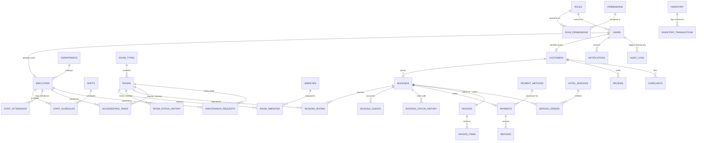

# HABESHA HOTEL MANAGEMENT SYSTEM (SHMS)
# Complete Entity-Relationship (ER) Architecture Specification

**Project:** Habesha Hotel Management System (Smart Hotel Management System - SHMS)  
**Database Name:** `shms`  
**Engine:** MySQL 8.0+ / InnoDB (ACID Compliant)  
**Character Set:** `utf8mb4` / Collation: `utf8mb4_unicode_ci`  
**Table Count:** 37 Normalized Tables (Third Normal Form - 3NF)  
**Relationship Count:** 54 Master Foreign Key Constraints  
**Documentation Version:** 2.4.0 (Production Architecture Edition)  
**Date:** March 2026 / Miazia 2018 E.C.  

---

## Table of Contents

1. [Executive Architectural Overview](#1-executive-architectural-overview)
2. [Master High-Resolution Visual ER Diagrams](#2-master-high-resolution-visual-er-diagrams)
3. [Complete System Mermaid ER Model](#3-complete-system-mermaid-er-model)
4. [Domain-by-Domain Modular Sub-Schemas](#4-domain-by-domain-modular-sub-schemas)
   - [4.1 Core Security & Access Control (RBAC)](#41-core-security--access-control-rbac)
   - [4.2 Staff & Human Resources Operations](#42-staff--human-resources-operations)
   - [4.3 Guest Profile Management](#43-guest-profile-management)
   - [4.4 Room & Accommodation Inventory](#44-room--accommodation-inventory)
   - [4.5 Reservation & Booking Engine](#45-reservation--booking-engine)
   - [4.6 Billing, Invoicing & Financial Operations](#46-billing-invoicing--financial-operations)
   - [4.7 Food & Dining / Hotel Services](#47-food--dining--hotel-services)
   - [4.8 Housekeeping & Facility Maintenance](#48-housekeeping--facility-maintenance)
   - [4.9 Material Inventory & Stock Control](#49-material-inventory--stock-control)
   - [4.10 System Governance, Auditing & Configuration](#410-system-governance-auditing--configuration)
5. [Entity Cardinality & Multiplicity Matrix](#5-entity-cardinality--multiplicity-matrix)
6. [Referential Integrity & Cascade Action Rules](#6-referential-integrity--cascade-action-rules)

---

## 1. Executive Architectural Overview

The **Habesha Hotel Management System (SHMS)** is architected on a normalized relational schema composed of **37 discrete tables** organized into **10 functional business domains**. The schema guarantees strict **Third Normal Form (3NF)** data integrity, eliminating functional dependencies, transitive dependencies, and redundancy while preserving lightning-fast query performance across multi-table joins.

### Key Architectural Tenets:
- **100% Normalized Primary Keys:** Every table features an explicit `id INT AUTO_INCREMENT PRIMARY KEY` (or a composite primary key in junction tables like `role_permissions` and `room_amenities`).
- **Strict Referential Integrity:** All foreign key constraints are enforced with exact `ON DELETE CASCADE`, `ON DELETE RESTRICT`, or `ON DELETE SET NULL` rules matching real-world hotel governance requirements.
- **Financial Precision:** All monetary sums, charges, tax levies, discounts, and ledger calculations are stored strictly in `DECIMAL(10,2)` precision, supporting both Ethiopian Birr (ETB) and US Dollars (USD).
- **Audit Trails:** Immutable audit logging (`audit_logs`), room status histories (`room_status_history`), and reservation transition records (`booking_status_history`) record every operational mutation with timestamps and actor signatures.

---

## 2. Master High-Resolution Visual ER Diagram

The database architecture is visually rendered in high-density format (PNG) inside this directory:

- **High-Resolution Modern Light Blueprint (PNG):** [`docs/ER_DIAGRAM.png`](ER_DIAGRAM.png)

---

## 3. Complete System Mermaid ER Model

---

## 4. Domain-by-Domain Modular Sub-Schemas

### 4.1 Core Security & Access Control (RBAC)

#### Table: `roles`

| # | Column | Type | Constraints | Description |
|---|---|---|---|---|
| 1 | `id` | `INT` | **PK**, AUTO_INCREMENT, DEFAULT NULL | Surrogate Primary Key |
| 2 | `name` | `VARCHAR(50)` | NOT NULL | System attribute |
| 3 | `description` | `TEXT` | DEFAULT NULL | System attribute |
| 4 | `created_at` | `DATETIME` | DEFAULT CURRENT_TIMESTAMP | Creation timestamp |

#### Table: `permissions`

| # | Column | Type | Constraints | Description |
|---|---|---|---|---|
| 1 | `id` | `INT` | **PK**, AUTO_INCREMENT, DEFAULT NULL | Surrogate Primary Key |
| 2 | `code` | `VARCHAR(100)` | NOT NULL | System attribute |
| 3 | `description` | `TEXT` | DEFAULT NULL | System attribute |
| 4 | `module` | `VARCHAR(50)` | NOT NULL | System attribute |

#### Table: `role_permissions`

| # | Column | Type | Constraints | Description |
|---|---|---|---|---|
| 1 | `role_id` | `INT` | **PK**, **FK** -> `roles.id`, NOT NULL | Foreign key reference with ON DELETE CASCADE |
| 2 | `permission_id` | `INT` | **PK**, **FK** -> `permissions.id`, NOT NULL | Foreign key reference with ON DELETE CASCADE |

#### Table: `users`

| # | Column | Type | Constraints | Description |
|---|---|---|---|---|
| 1 | `id` | `INT` | **PK**, AUTO_INCREMENT, DEFAULT NULL | Surrogate Primary Key |
| 2 | `email` | `VARCHAR(255)` | NOT NULL | System attribute |
| 3 | `password_hash` | `TEXT` | NOT NULL | System attribute |
| 4 | `role` | `VARCHAR(50)` | NOT NULL, DEFAULT 'customer' | System attribute |
| 5 | `full_name` | `VARCHAR(255)` | NOT NULL | System attribute |
| 6 | `phone` | `VARCHAR(50)` | DEFAULT NULL | System attribute |
| 7 | `avatar_url` | `TEXT` | DEFAULT NULL | System attribute |
| 8 | `is_active` | `TINYINT(1)` | NOT NULL, DEFAULT 1 | System attribute |
| 9 | `created_at` | `DATETIME` | DEFAULT CURRENT_TIMESTAMP | Creation timestamp |
| 10 | `updated_at` | `DATETIME` | DEFAULT CURRENT_TIMESTAMP ON UPDATE CURRENT_TIMESTAMP | Last update timestamp |

### 4.2 Staff & Human Resources Operations

#### Table: `departments`

| # | Column | Type | Constraints | Description |
|---|---|---|---|---|
| 1 | `id` | `INT` | **PK**, AUTO_INCREMENT, DEFAULT NULL | Surrogate Primary Key |
| 2 | `name` | `VARCHAR(100)` | NOT NULL | System attribute |
| 3 | `description` | `TEXT` | DEFAULT NULL | System attribute |
| 4 | `created_at` | `DATETIME` | DEFAULT CURRENT_TIMESTAMP | Creation timestamp |
| 5 | `updated_at` | `DATETIME` | DEFAULT CURRENT_TIMESTAMP ON UPDATE CURRENT_TIMESTAMP | Last update timestamp |

#### Table: `employees`

| # | Column | Type | Constraints | Description |
|---|---|---|---|---|
| 1 | `id` | `INT` | **PK**, AUTO_INCREMENT, DEFAULT NULL | Surrogate Primary Key |
| 2 | `user_id` | `INT` | **FK** -> `users.id`, NOT NULL | Foreign key reference with ON DELETE CASCADE |
| 3 | `department_id` | `INT` | **FK** -> `departments.id`, DEFAULT NULL | Foreign key reference with ON DELETE SET NULL |
| 4 | `employee_code` | `VARCHAR(50)` | NOT NULL | System attribute |
| 5 | `position` | `VARCHAR(100)` | NOT NULL | System attribute |
| 6 | `salary` | `DECIMAL(10,2)` | DEFAULT 0.00 | System attribute |
| 7 | `hire_date` | `DATE` | NOT NULL | System attribute |
| 8 | `status` | `ENUM('active','on_leave','terminated')` | NOT NULL, DEFAULT 'active' | System attribute |
| 9 | `created_at` | `DATETIME` | DEFAULT CURRENT_TIMESTAMP | Creation timestamp |
| 10 | `updated_at` | `DATETIME` | DEFAULT CURRENT_TIMESTAMP ON UPDATE CURRENT_TIMESTAMP | Last update timestamp |

#### Table: `shifts`

| # | Column | Type | Constraints | Description |
|---|---|---|---|---|
| 1 | `id` | `INT` | **PK**, AUTO_INCREMENT, DEFAULT NULL | Surrogate Primary Key |
| 2 | `name` | `VARCHAR(50)` | NOT NULL | System attribute |
| 3 | `code` | `VARCHAR(20)` | NOT NULL | System attribute |
| 4 | `start_time` | `TIME` | NOT NULL | System attribute |
| 5 | `end_time` | `TIME` | NOT NULL | System attribute |
| 6 | `description` | `TEXT` | DEFAULT NULL | System attribute |
| 7 | `created_at` | `DATETIME` | DEFAULT CURRENT_TIMESTAMP | Creation timestamp |
| 8 | `updated_at` | `DATETIME` | DEFAULT CURRENT_TIMESTAMP ON UPDATE CURRENT_TIMESTAMP | Last update timestamp |

#### Table: `staff_schedules`

| # | Column | Type | Constraints | Description |
|---|---|---|---|---|
| 1 | `id` | `INT` | **PK**, AUTO_INCREMENT, DEFAULT NULL | Surrogate Primary Key |
| 2 | `employee_id` | `INT` | **FK** -> `employees.id`, NOT NULL | Foreign key reference with ON DELETE CASCADE |
| 3 | `shift_id` | `INT` | **FK** -> `shifts.id`, NOT NULL | Foreign key reference with ON DELETE RESTRICT |
| 4 | `department_id` | `INT` | **FK** -> `departments.id`, DEFAULT NULL | Foreign key reference with ON DELETE SET NULL |
| 5 | `work_date` | `DATE` | NOT NULL | System attribute |
| 6 | `status` | `ENUM('scheduled','completed','absent','swapped','cancelled')` | NOT NULL, DEFAULT 'scheduled' | System attribute |
| 7 | `notes` | `TEXT` | DEFAULT NULL | System attribute |
| 8 | `created_at` | `DATETIME` | DEFAULT CURRENT_TIMESTAMP | Creation timestamp |
| 9 | `updated_at` | `DATETIME` | DEFAULT CURRENT_TIMESTAMP ON UPDATE CURRENT_TIMESTAMP | Last update timestamp |

#### Table: `staff_attendance`

| # | Column | Type | Constraints | Description |
|---|---|---|---|---|
| 1 | `id` | `INT` | **PK**, AUTO_INCREMENT, DEFAULT NULL | Surrogate Primary Key |
| 2 | `employee_id` | `INT` | **FK** -> `employees.id`, NOT NULL | Foreign key reference with ON DELETE CASCADE |
| 3 | `schedule_id` | `INT` | **FK** -> `staff_schedules.id`, DEFAULT NULL | Foreign key reference with ON DELETE SET NULL |
| 4 | `attendance_date` | `DATE` | NOT NULL | System attribute |
| 5 | `clock_in` | `DATETIME` | DEFAULT NULL | System attribute |
| 6 | `clock_out` | `DATETIME` | DEFAULT NULL | System attribute |
| 7 | `total_hours` | `DECIMAL(4,2)` | DEFAULT 0.00 | System attribute |
| 8 | `status` | `ENUM('present','late','absent','half_day','on_leave')` | NOT NULL, DEFAULT 'present' | System attribute |
| 9 | `notes` | `TEXT` | DEFAULT NULL | System attribute |
| 10 | `recorded_by` | `INT` | **FK** -> `users.id`, DEFAULT NULL | Foreign key reference with ON DELETE SET NULL |
| 11 | `created_at` | `DATETIME` | DEFAULT CURRENT_TIMESTAMP | Creation timestamp |
| 12 | `updated_at` | `DATETIME` | DEFAULT CURRENT_TIMESTAMP ON UPDATE CURRENT_TIMESTAMP | Last update timestamp |

### 4.3 Guest & Customer Profile Management

#### Table: `customers`

| # | Column | Type | Constraints | Description |
|---|---|---|---|---|
| 1 | `id` | `INT` | **PK**, AUTO_INCREMENT, DEFAULT NULL | Surrogate Primary Key |
| 2 | `user_id` | `INT` | **FK** -> `users.id`, DEFAULT NULL | Foreign key reference with ON DELETE SET NULL |
| 3 | `full_name` | `VARCHAR(255)` | NOT NULL | System attribute |
| 4 | `email` | `VARCHAR(255)` | NOT NULL | System attribute |
| 5 | `phone` | `VARCHAR(50)` | DEFAULT NULL | System attribute |
| 6 | `address` | `TEXT` | DEFAULT NULL | System attribute |
| 7 | `country` | `VARCHAR(100)` | DEFAULT 'Ethiopia' | System attribute |
| 8 | `id_document_type` | `VARCHAR(50)` | DEFAULT 'Passport' | System attribute |
| 9 | `id_document_number` | `VARCHAR(100)` | DEFAULT NULL | System attribute |
| 10 | `preferences` | `TEXT` | DEFAULT NULL | System attribute |
| 11 | `special_requests` | `TEXT` | DEFAULT NULL | System attribute |
| 12 | `created_at` | `DATETIME` | DEFAULT CURRENT_TIMESTAMP | Creation timestamp |
| 13 | `updated_at` | `DATETIME` | DEFAULT CURRENT_TIMESTAMP ON UPDATE CURRENT_TIMESTAMP | Last update timestamp |

### 4.4 Room & Accommodation Inventory

#### Table: `room_types`

| # | Column | Type | Constraints | Description |
|---|---|---|---|---|
| 1 | `id` | `INT` | **PK**, AUTO_INCREMENT, DEFAULT NULL | Surrogate Primary Key |
| 2 | `name` | `VARCHAR(100)` | NOT NULL | System attribute |
| 3 | `code` | `VARCHAR(20)` | NOT NULL | System attribute |
| 4 | `description` | `TEXT` | NOT NULL | System attribute |
| 5 | `base_price` | `DECIMAL(10,2)` | NOT NULL | Financial amount in ETB/USD (DECIMAL 10,2) |
| 6 | `capacity` | `INT` | NOT NULL, DEFAULT 2 | System attribute |
| 7 | `bed_type` | `VARCHAR(50)` | NOT NULL | System attribute |
| 8 | `beds_count` | `INT` | NOT NULL, DEFAULT 1 | System attribute |
| 9 | `size_sqm` | `INT` | NOT NULL, DEFAULT 35 | System attribute |
| 10 | `image_url` | `TEXT` | DEFAULT NULL | System attribute |
| 11 | `gallery_urls` | `TEXT` | DEFAULT NULL | System attribute |
| 12 | `created_at` | `DATETIME` | DEFAULT CURRENT_TIMESTAMP | Creation timestamp |
| 13 | `updated_at` | `DATETIME` | DEFAULT CURRENT_TIMESTAMP ON UPDATE CURRENT_TIMESTAMP | Last update timestamp |

#### Table: `rooms`

| # | Column | Type | Constraints | Description |
|---|---|---|---|---|
| 1 | `id` | `INT` | **PK**, AUTO_INCREMENT, DEFAULT NULL | Surrogate Primary Key |
| 2 | `room_number` | `VARCHAR(20)` | NOT NULL | System attribute |
| 3 | `room_type_id` | `INT` | **FK** -> `room_types.id`, NOT NULL | Foreign key reference with ON DELETE RESTRICT |
| 4 | `floor_number` | `INT` | NOT NULL | System attribute |
| 5 | `status` | `ENUM('available','reserved','occupied','dirty','cleaning','maintenance','out_of_service')` | NOT NULL, DEFAULT 'available' | System attribute |
| 6 | `operational_status` | `ENUM('ready','needs_cleaning','cleaning_in_progress','under_repair','out_of_order')` | NOT NULL, DEFAULT 'ready' | System attribute |
| 7 | `price_per_night` | `DECIMAL(10,2)` | NOT NULL | Financial amount in ETB/USD (DECIMAL 10,2) |
| 8 | `is_active` | `TINYINT(1)` | NOT NULL, DEFAULT 1 | System attribute |
| 9 | `notes` | `TEXT` | DEFAULT NULL | System attribute |
| 10 | `created_at` | `DATETIME` | DEFAULT CURRENT_TIMESTAMP | Creation timestamp |
| 11 | `updated_at` | `DATETIME` | DEFAULT CURRENT_TIMESTAMP ON UPDATE CURRENT_TIMESTAMP | Last update timestamp |

#### Table: `amenities`

| # | Column | Type | Constraints | Description |
|---|---|---|---|---|
| 1 | `id` | `INT` | **PK**, AUTO_INCREMENT, DEFAULT NULL | Surrogate Primary Key |
| 2 | `name` | `VARCHAR(100)` | NOT NULL | System attribute |
| 3 | `icon` | `VARCHAR(50)` | DEFAULT 'Sparkles' | System attribute |
| 4 | `description` | `TEXT` | DEFAULT NULL | System attribute |
| 5 | `category` | `VARCHAR(50)` | DEFAULT 'general' | System attribute |
| 6 | `created_at` | `DATETIME` | DEFAULT CURRENT_TIMESTAMP | Creation timestamp |

#### Table: `room_amenities`

| # | Column | Type | Constraints | Description |
|---|---|---|---|---|
| 1 | `room_id` | `INT` | **PK**, **FK** -> `rooms.id`, NOT NULL | Foreign key reference with ON DELETE CASCADE |
| 2 | `amenity_id` | `INT` | **PK**, **FK** -> `amenities.id`, NOT NULL | Foreign key reference with ON DELETE CASCADE |

#### Table: `room_status_history`

| # | Column | Type | Constraints | Description |
|---|---|---|---|---|
| 1 | `id` | `INT` | **PK**, AUTO_INCREMENT, DEFAULT NULL | Surrogate Primary Key |
| 2 | `room_id` | `INT` | **FK** -> `rooms.id`, NOT NULL | Foreign key reference with ON DELETE CASCADE |
| 3 | `previous_status` | `VARCHAR(50)` | NOT NULL | System attribute |
| 4 | `new_status` | `VARCHAR(50)` | NOT NULL | System attribute |
| 5 | `changed_by` | `INT` | **FK** -> `users.id`, DEFAULT NULL | Foreign key reference with ON DELETE SET NULL |
| 6 | `reason` | `TEXT` | DEFAULT NULL | System attribute |
| 7 | `created_at` | `DATETIME` | DEFAULT CURRENT_TIMESTAMP | Creation timestamp |

### 4.5 Reservation & Booking Engine

#### Table: `bookings`

| # | Column | Type | Constraints | Description |
|---|---|---|---|---|
| 1 | `id` | `INT` | **PK**, AUTO_INCREMENT, DEFAULT NULL | Surrogate Primary Key |
| 2 | `booking_reference` | `VARCHAR(50)` | NOT NULL | System attribute |
| 3 | `customer_id` | `INT` | **FK** -> `customers.id`, NOT NULL | Foreign key reference with ON DELETE RESTRICT |
| 4 | `room_id` | `INT` | **FK** -> `rooms.id`, NOT NULL | Foreign key reference with ON DELETE RESTRICT |
| 5 | `actual_check_in` | `DATETIME` | DEFAULT NULL | System attribute |
| 6 | `actual_check_out` | `DATETIME` | DEFAULT NULL | System attribute |
| 7 | `adults_count` | `INT` | NOT NULL, DEFAULT 1 | System attribute |
| 8 | `children_count` | `INT` | NOT NULL, DEFAULT 0 | System attribute |
| 9 | `nights_count` | `INT` | NOT NULL, DEFAULT 1 | System attribute |
| 10 | `room_rate` | `DECIMAL(10,2)` | NOT NULL | System attribute |
| 11 | `services_total` | `DECIMAL(10,2)` | NOT NULL, DEFAULT 0.00 | System attribute |
| 12 | `tax_amount` | `DECIMAL(10,2)` | NOT NULL, DEFAULT 0.00 | Financial amount in ETB/USD (DECIMAL 10,2) |
| 13 | `discount_amount` | `DECIMAL(10,2)` | NOT NULL, DEFAULT 0.00 | Financial amount in ETB/USD (DECIMAL 10,2) |
| 14 | `total_amount` | `DECIMAL(10,2)` | NOT NULL | Financial amount in ETB/USD (DECIMAL 10,2) |
| 15 | `paid_amount` | `DECIMAL(10,2)` | NOT NULL, DEFAULT 0.00 | Financial amount in ETB/USD (DECIMAL 10,2) |
| 16 | `status` | `ENUM('pending','confirmed','checked_in','checked_out','cancelled','no_show')` | NOT NULL, DEFAULT 'confirmed' | System attribute |
| 17 | `payment_status` | `ENUM('pending','partially_paid','paid','refunded')` | NOT NULL, DEFAULT 'pending' | System attribute |
| 18 | `special_requests` | `TEXT` | DEFAULT NULL | System attribute |
| 19 | `created_at` | `DATETIME` | DEFAULT CURRENT_TIMESTAMP | Creation timestamp |
| 20 | `updated_at` | `DATETIME` | DEFAULT CURRENT_TIMESTAMP ON UPDATE CURRENT_TIMESTAMP | Last update timestamp |

#### Table: `booking_rooms`

| # | Column | Type | Constraints | Description |
|---|---|---|---|---|
| 1 | `id` | `INT` | **PK**, AUTO_INCREMENT, DEFAULT NULL | Surrogate Primary Key |
| 2 | `booking_id` | `INT` | **FK** -> `bookings.id`, NOT NULL | Foreign key reference with ON DELETE CASCADE |
| 3 | `room_id` | `INT` | **FK** -> `rooms.id`, NOT NULL | Foreign key reference with ON DELETE RESTRICT |
| 4 | `night_rate` | `DECIMAL(10,2)` | NOT NULL | System attribute |

#### Table: `booking_guests`

| # | Column | Type | Constraints | Description |
|---|---|---|---|---|
| 1 | `id` | `INT` | **PK**, AUTO_INCREMENT, DEFAULT NULL | Surrogate Primary Key |
| 2 | `booking_id` | `INT` | **FK** -> `bookings.id`, NOT NULL | Foreign key reference with ON DELETE CASCADE |
| 3 | `full_name` | `VARCHAR(255)` | NOT NULL | System attribute |
| 4 | `email` | `VARCHAR(255)` | DEFAULT NULL | System attribute |
| 5 | `phone` | `VARCHAR(50)` | DEFAULT NULL | System attribute |
| 6 | `is_primary` | `TINYINT(1)` | NOT NULL, DEFAULT 0 | System attribute |
| 7 | `created_at` | `DATETIME` | DEFAULT CURRENT_TIMESTAMP | Creation timestamp |

#### Table: `booking_status_history`

| # | Column | Type | Constraints | Description |
|---|---|---|---|---|
| 1 | `id` | `INT` | **PK**, AUTO_INCREMENT, DEFAULT NULL | Surrogate Primary Key |
| 2 | `booking_id` | `INT` | **FK** -> `bookings.id`, NOT NULL | Foreign key reference with ON DELETE CASCADE |
| 3 | `previous_status` | `VARCHAR(50)` | NOT NULL | System attribute |
| 4 | `new_status` | `VARCHAR(50)` | NOT NULL | System attribute |
| 5 | `changed_by` | `INT` | **FK** -> `users.id`, DEFAULT NULL | Foreign key reference with ON DELETE SET NULL |
| 6 | `notes` | `TEXT` | DEFAULT NULL | System attribute |
| 7 | `created_at` | `DATETIME` | DEFAULT CURRENT_TIMESTAMP | Creation timestamp |

### 4.6 Financial Billing, Invoicing & Payments

#### Table: `payment_methods`

| # | Column | Type | Constraints | Description |
|---|---|---|---|---|
| 1 | `id` | `INT` | **PK**, AUTO_INCREMENT, DEFAULT NULL | Surrogate Primary Key |
| 2 | `code` | `VARCHAR(50)` | NOT NULL | System attribute |
| 3 | `name` | `VARCHAR(100)` | NOT NULL | System attribute |
| 4 | `type` | `ENUM('mobile_money','bank_transfer','card','cash','other')` | NOT NULL, DEFAULT 'mobile_money' | System attribute |
| 5 | `currency` | `VARCHAR(10)` | NOT NULL, DEFAULT 'ETB' | System attribute |
| 6 | `is_active` | `TINYINT(1)` | NOT NULL, DEFAULT 1 | System attribute |
| 7 | `account_number` | `VARCHAR(100)` | DEFAULT NULL | System attribute |
| 8 | `instructions` | `TEXT` | DEFAULT NULL | System attribute |
| 9 | `created_at` | `DATETIME` | DEFAULT CURRENT_TIMESTAMP | Creation timestamp |
| 10 | `updated_at` | `DATETIME` | DEFAULT CURRENT_TIMESTAMP ON UPDATE CURRENT_TIMESTAMP | Last update timestamp |

#### Table: `payments`

| # | Column | Type | Constraints | Description |
|---|---|---|---|---|
| 1 | `id` | `INT` | **PK**, AUTO_INCREMENT, DEFAULT NULL | Surrogate Primary Key |
| 2 | `booking_id` | `INT` | **FK** -> `bookings.id`, NOT NULL | Foreign key reference with ON DELETE CASCADE |
| 3 | `payment_reference` | `VARCHAR(100)` | NOT NULL | System attribute |
| 4 | `amount` | `DECIMAL(10,2)` | NOT NULL | Financial amount in ETB/USD (DECIMAL 10,2) |
| 5 | `payment_method` | `VARCHAR(50)` | NOT NULL, DEFAULT 'telebirr' | System attribute |
| 6 | `status` | `ENUM('pending','completed','failed','refunded')` | NOT NULL, DEFAULT 'completed' | System attribute |
| 7 | `notes` | `TEXT` | DEFAULT NULL | System attribute |
| 8 | `recorded_by` | `INT` | **FK** -> `users.id`, DEFAULT NULL | Foreign key reference with ON DELETE SET NULL |
| 9 | `created_at` | `DATETIME` | DEFAULT CURRENT_TIMESTAMP | Creation timestamp |
| 10 | `updated_at` | `DATETIME` | DEFAULT CURRENT_TIMESTAMP ON UPDATE CURRENT_TIMESTAMP | Last update timestamp |

#### Table: `refunds`

| # | Column | Type | Constraints | Description |
|---|---|---|---|---|
| 1 | `id` | `INT` | **PK**, AUTO_INCREMENT, DEFAULT NULL | Surrogate Primary Key |
| 2 | `refund_number` | `VARCHAR(50)` | NOT NULL | System attribute |
| 3 | `payment_id` | `INT` | **FK** -> `payments.id`, NOT NULL | Foreign key reference with ON DELETE RESTRICT |
| 4 | `booking_id` | `INT` | **FK** -> `bookings.id`, NOT NULL | Foreign key reference with ON DELETE CASCADE |
| 5 | `amount` | `DECIMAL(10,2)` | NOT NULL | Financial amount in ETB/USD (DECIMAL 10,2) |
| 6 | `currency` | `VARCHAR(10)` | NOT NULL, DEFAULT 'ETB' | System attribute |
| 7 | `refund_method` | `VARCHAR(50)` | NOT NULL, DEFAULT 'telebirr' | System attribute |
| 8 | `reason` | `TEXT` | NOT NULL | System attribute |
| 9 | `status` | `ENUM('pending','completed','rejected')` | NOT NULL, DEFAULT 'completed' | System attribute |
| 10 | `processed_by` | `INT` | **FK** -> `users.id`, DEFAULT NULL | Foreign key reference with ON DELETE SET NULL |
| 11 | `notes` | `TEXT` | DEFAULT NULL | System attribute |
| 12 | `created_at` | `DATETIME` | DEFAULT CURRENT_TIMESTAMP | Creation timestamp |
| 13 | `updated_at` | `DATETIME` | DEFAULT CURRENT_TIMESTAMP ON UPDATE CURRENT_TIMESTAMP | Last update timestamp |

#### Table: `invoices`

| # | Column | Type | Constraints | Description |
|---|---|---|---|---|
| 1 | `id` | `INT` | **PK**, AUTO_INCREMENT, DEFAULT NULL | Surrogate Primary Key |
| 2 | `invoice_number` | `VARCHAR(50)` | NOT NULL | System attribute |
| 3 | `booking_id` | `INT` | **FK** -> `bookings.id`, NOT NULL | Foreign key reference with ON DELETE CASCADE |
| 4 | `customer_id` | `INT` | **FK** -> `customers.id`, NOT NULL | Foreign key reference with ON DELETE RESTRICT |
| 5 | `subtotal` | `DECIMAL(10,2)` | NOT NULL | System attribute |
| 6 | `tax_amount` | `DECIMAL(10,2)` | NOT NULL | Financial amount in ETB/USD (DECIMAL 10,2) |
| 7 | `discount_amount` | `DECIMAL(10,2)` | NOT NULL, DEFAULT 0.00 | Financial amount in ETB/USD (DECIMAL 10,2) |
| 8 | `total_amount` | `DECIMAL(10,2)` | NOT NULL | Financial amount in ETB/USD (DECIMAL 10,2) |
| 9 | `paid_amount` | `DECIMAL(10,2)` | NOT NULL, DEFAULT 0.00 | Financial amount in ETB/USD (DECIMAL 10,2) |
| 10 | `balance_due` | `DECIMAL(10,2)` | NOT NULL, DEFAULT 0.00 | System attribute |
| 11 | `status` | `ENUM('unpaid','partially_paid','paid','cancelled')` | NOT NULL, DEFAULT 'unpaid' | System attribute |
| 12 | `due_date` | `DATE` | NOT NULL | System attribute |
| 13 | `created_at` | `DATETIME` | DEFAULT CURRENT_TIMESTAMP | Creation timestamp |
| 14 | `updated_at` | `DATETIME` | DEFAULT CURRENT_TIMESTAMP ON UPDATE CURRENT_TIMESTAMP | Last update timestamp |

#### Table: `invoice_items`

| # | Column | Type | Constraints | Description |
|---|---|---|---|---|
| 1 | `id` | `INT` | **PK**, AUTO_INCREMENT, DEFAULT NULL | Surrogate Primary Key |
| 2 | `invoice_id` | `INT` | **FK** -> `invoices.id`, NOT NULL | Foreign key reference with ON DELETE CASCADE |
| 3 | `description` | `TEXT` | NOT NULL | System attribute |
| 4 | `quantity` | `INT` | NOT NULL, DEFAULT 1 | System attribute |
| 5 | `unit_price` | `DECIMAL(10,2)` | NOT NULL | Financial amount in ETB/USD (DECIMAL 10,2) |
| 6 | `total_price` | `DECIMAL(10,2)` | NOT NULL | Financial amount in ETB/USD (DECIMAL 10,2) |
| 7 | `item_type` | `ENUM('room_charge','service','tax','discount','extra')` | DEFAULT 'room_charge' | System attribute |
| 8 | `created_at` | `DATETIME` | DEFAULT CURRENT_TIMESTAMP | Creation timestamp |

#### Table: `expenses`

| # | Column | Type | Constraints | Description |
|---|---|---|---|---|
| 1 | `id` | `INT` | **PK**, AUTO_INCREMENT, DEFAULT NULL | Surrogate Primary Key |
| 2 | `category` | `VARCHAR(100)` | NOT NULL | System attribute |
| 3 | `title` | `VARCHAR(255)` | NOT NULL | System attribute |
| 4 | `amount` | `DECIMAL(10,2)` | NOT NULL | Financial amount in ETB/USD (DECIMAL 10,2) |
| 5 | `currency` | `VARCHAR(10)` | DEFAULT 'ETB' | System attribute |
| 6 | `payment_method` | `VARCHAR(50)` | DEFAULT 'bank_transfer' | System attribute |
| 7 | `reference_number` | `VARCHAR(100)` | DEFAULT NULL | System attribute |
| 8 | `expense_date` | `DATE` | NOT NULL | System attribute |
| 9 | `recorded_by` | `INT` | **FK** -> `users.id`, DEFAULT NULL | Foreign key reference with ON DELETE SET NULL |
| 10 | `notes` | `TEXT` | DEFAULT NULL | System attribute |
| 11 | `created_at` | `DATETIME` | DEFAULT CURRENT_TIMESTAMP | Creation timestamp |
| 12 | `updated_at` | `DATETIME` | DEFAULT CURRENT_TIMESTAMP ON UPDATE CURRENT_TIMESTAMP | Last update timestamp |

#### Table: `discounts`

| # | Column | Type | Constraints | Description |
|---|---|---|---|---|
| 1 | `id` | `INT` | **PK**, AUTO_INCREMENT, DEFAULT NULL | Surrogate Primary Key |
| 2 | `code` | `VARCHAR(50)` | NOT NULL | System attribute |
| 3 | `name` | `VARCHAR(100)` | NOT NULL | System attribute |
| 4 | `discount_type` | `ENUM('percentage','fixed_amount')` | NOT NULL, DEFAULT 'percentage' | System attribute |
| 5 | `value` | `DECIMAL(10,2)` | NOT NULL | System attribute |
| 6 | `min_spend` | `DECIMAL(10,2)` | DEFAULT 0.00 | System attribute |
| 7 | `max_discount` | `DECIMAL(10,2)` | DEFAULT NULL | System attribute |
| 8 | `valid_from` | `DATE` | NOT NULL | System attribute |
| 9 | `valid_until` | `DATE` | NOT NULL | System attribute |
| 10 | `max_uses` | `INT` | DEFAULT 100 | System attribute |
| 11 | `current_uses` | `INT` | DEFAULT 0 | System attribute |
| 12 | `is_active` | `TINYINT(1)` | NOT NULL, DEFAULT 1 | System attribute |
| 13 | `created_at` | `DATETIME` | DEFAULT CURRENT_TIMESTAMP | Creation timestamp |
| 14 | `updated_at` | `DATETIME` | DEFAULT CURRENT_TIMESTAMP ON UPDATE CURRENT_TIMESTAMP | Last update timestamp |

### 4.7 Food & Dining / Hotel Services

#### Table: `hotel_services`

| # | Column | Type | Constraints | Description |
|---|---|---|---|---|
| 1 | `id` | `INT` | **PK**, AUTO_INCREMENT, DEFAULT NULL | Surrogate Primary Key |
| 2 | `name` | `VARCHAR(200)` | NOT NULL | System attribute |
| 3 | `category` | `ENUM('dining','spa','transport','laundry','conference','room_service','other')` | NOT NULL | System attribute |
| 4 | `price` | `DECIMAL(10,2)` | NOT NULL | Financial amount in ETB/USD (DECIMAL 10,2) |
| 5 | `description` | `TEXT` | DEFAULT NULL | System attribute |
| 6 | `icon` | `VARCHAR(50)` | DEFAULT 'Coffee' | System attribute |
| 7 | `is_available` | `TINYINT(1)` | NOT NULL, DEFAULT 1 | System attribute |
| 8 | `created_at` | `DATETIME` | DEFAULT CURRENT_TIMESTAMP | Creation timestamp |
| 9 | `updated_at` | `DATETIME` | DEFAULT CURRENT_TIMESTAMP ON UPDATE CURRENT_TIMESTAMP | Last update timestamp |

#### Table: `service_orders`

| # | Column | Type | Constraints | Description |
|---|---|---|---|---|
| 1 | `id` | `INT` | **PK**, AUTO_INCREMENT, DEFAULT NULL | Surrogate Primary Key |
| 2 | `booking_id` | `INT` | **FK** -> `bookings.id`, NOT NULL | Foreign key reference with ON DELETE CASCADE |
| 3 | `service_id` | `INT` | **FK** -> `hotel_services.id`, NOT NULL | Foreign key reference with ON DELETE RESTRICT |
| 4 | `quantity` | `INT` | NOT NULL, DEFAULT 1 | System attribute |
| 5 | `unit_price` | `DECIMAL(10,2)` | NOT NULL | Financial amount in ETB/USD (DECIMAL 10,2) |
| 6 | `total_price` | `DECIMAL(10,2)` | NOT NULL | Financial amount in ETB/USD (DECIMAL 10,2) |
| 7 | `status` | `ENUM('pending','in_progress','completed','cancelled')` | NOT NULL, DEFAULT 'pending' | System attribute |
| 8 | `order_time` | `DATETIME` | DEFAULT CURRENT_TIMESTAMP | System attribute |
| 9 | `delivered_time` | `DATETIME` | DEFAULT NULL | System attribute |
| 10 | `notes` | `TEXT` | DEFAULT NULL | System attribute |
| 11 | `ordered_by` | `INT` | **FK** -> `users.id`, DEFAULT NULL | Foreign key reference with ON DELETE SET NULL |
| 12 | `created_at` | `DATETIME` | DEFAULT CURRENT_TIMESTAMP | Creation timestamp |
| 13 | `updated_at` | `DATETIME` | DEFAULT CURRENT_TIMESTAMP ON UPDATE CURRENT_TIMESTAMP | Last update timestamp |

### 4.8 Housekeeping & Facility Maintenance

#### Table: `housekeeping_tasks`

| # | Column | Type | Constraints | Description |
|---|---|---|---|---|
| 1 | `id` | `INT` | **PK**, AUTO_INCREMENT, DEFAULT NULL | Surrogate Primary Key |
| 2 | `room_id` | `INT` | **FK** -> `rooms.id`, NOT NULL | Foreign key reference with ON DELETE CASCADE |
| 3 | `assigned_employee_id` | `INT` | **FK** -> `employees.id`, DEFAULT NULL | Foreign key reference with ON DELETE SET NULL |
| 4 | `task_type` | `ENUM('standard_clean','deep_clean','turn_down','inspection','sanitization')` | NOT NULL, DEFAULT 'standard_clean' | System attribute |
| 5 | `priority` | `ENUM('low','medium','high','urgent')` | NOT NULL, DEFAULT 'medium' | System attribute |
| 6 | `status` | `ENUM('pending','in_progress','completed','verified')` | NOT NULL, DEFAULT 'pending' | System attribute |
| 7 | `instructions` | `TEXT` | DEFAULT NULL | System attribute |
| 8 | `scheduled_for` | `DATE` | DEFAULT NULL | System attribute |
| 9 | `started_at` | `DATETIME` | DEFAULT NULL | System attribute |
| 10 | `completed_at` | `DATETIME` | DEFAULT NULL | System attribute |
| 11 | `created_at` | `DATETIME` | DEFAULT CURRENT_TIMESTAMP | Creation timestamp |
| 12 | `updated_at` | `DATETIME` | DEFAULT CURRENT_TIMESTAMP ON UPDATE CURRENT_TIMESTAMP | Last update timestamp |

#### Table: `maintenance_requests`

| # | Column | Type | Constraints | Description |
|---|---|---|---|---|
| 1 | `id` | `INT` | **PK**, AUTO_INCREMENT, DEFAULT NULL | Surrogate Primary Key |
| 2 | `room_id` | `INT` | **FK** -> `rooms.id`, NOT NULL | Foreign key reference with ON DELETE CASCADE |
| 3 | `reported_by` | `INT` | **FK** -> `users.id`, NOT NULL | Foreign key reference with ON DELETE RESTRICT |
| 4 | `technician_id` | `INT` | **FK** -> `employees.id`, DEFAULT NULL | Foreign key reference with ON DELETE SET NULL |
| 5 | `issue_title` | `VARCHAR(255)` | NOT NULL | System attribute |
| 6 | `description` | `TEXT` | NOT NULL | System attribute |
| 7 | `priority` | `ENUM('low','medium','high','critical')` | NOT NULL, DEFAULT 'medium' | System attribute |
| 8 | `status` | `ENUM('reported','in_progress','resolved','cancelled')` | NOT NULL, DEFAULT 'reported' | System attribute |
| 9 | `estimated_cost` | `DECIMAL(10,2)` | DEFAULT 0.00 | Financial amount in ETB/USD (DECIMAL 10,2) |
| 10 | `actual_cost` | `DECIMAL(10,2)` | DEFAULT 0.00 | Financial amount in ETB/USD (DECIMAL 10,2) |
| 11 | `reported_at` | `DATETIME` | DEFAULT CURRENT_TIMESTAMP | System attribute |
| 12 | `resolved_at` | `DATETIME` | DEFAULT NULL | System attribute |
| 13 | `resolution_notes` | `TEXT` | DEFAULT NULL | System attribute |
| 14 | `created_at` | `DATETIME` | DEFAULT CURRENT_TIMESTAMP | Creation timestamp |
| 15 | `updated_at` | `DATETIME` | DEFAULT CURRENT_TIMESTAMP ON UPDATE CURRENT_TIMESTAMP | Last update timestamp |

### 4.9 Material Inventory & Stock Control

#### Table: `inventory`

| # | Column | Type | Constraints | Description |
|---|---|---|---|---|
| 1 | `id` | `INT` | **PK**, AUTO_INCREMENT, DEFAULT NULL | Surrogate Primary Key |
| 2 | `item_code` | `VARCHAR(50)` | NOT NULL | System attribute |
| 3 | `name` | `VARCHAR(200)` | NOT NULL | System attribute |
| 4 | `category` | `ENUM('linen','toiletries','food_beverage','cleaning_supplies','maintenance_parts','stationery','other')` | NOT NULL | System attribute |
| 5 | `unit` | `VARCHAR(50)` | NOT NULL, DEFAULT 'pieces' | System attribute |
| 6 | `quantity_on_hand` | `DECIMAL(10,2)` | NOT NULL, DEFAULT 0.00 | System attribute |
| 7 | `reorder_level` | `DECIMAL(10,2)` | NOT NULL, DEFAULT 10.00 | System attribute |
| 8 | `unit_cost` | `DECIMAL(10,2)` | NOT NULL, DEFAULT 0.00 | Financial amount in ETB/USD (DECIMAL 10,2) |
| 9 | `currency` | `VARCHAR(10)` | DEFAULT 'ETB' | System attribute |
| 10 | `storage_location` | `VARCHAR(100)` | DEFAULT 'Central Store' | System attribute |
| 11 | `is_active` | `TINYINT(1)` | NOT NULL, DEFAULT 1 | System attribute |
| 12 | `created_at` | `DATETIME` | DEFAULT CURRENT_TIMESTAMP | Creation timestamp |
| 13 | `updated_at` | `DATETIME` | DEFAULT CURRENT_TIMESTAMP ON UPDATE CURRENT_TIMESTAMP | Last update timestamp |

#### Table: `inventory_transactions`

| # | Column | Type | Constraints | Description |
|---|---|---|---|---|
| 1 | `id` | `INT` | **PK**, AUTO_INCREMENT, DEFAULT NULL | Surrogate Primary Key |
| 2 | `inventory_id` | `INT` | **FK** -> `inventory.id`, NOT NULL | Foreign key reference with ON DELETE RESTRICT |
| 3 | `transaction_type` | `ENUM('purchase_in','usage_out','waste_loss','return_in','adjustment')` | NOT NULL | System attribute |
| 4 | `quantity` | `DECIMAL(10,2)` | NOT NULL | System attribute |
| 5 | `unit_price` | `DECIMAL(10,2)` | DEFAULT 0.00 | Financial amount in ETB/USD (DECIMAL 10,2) |
| 6 | `total_cost` | `DECIMAL(10,2)` | DEFAULT 0.00 | Financial amount in ETB/USD (DECIMAL 10,2) |
| 7 | `department_id` | `INT` | **FK** -> `departments.id`, DEFAULT NULL | Foreign key reference with ON DELETE SET NULL |
| 8 | `reference_type` | `VARCHAR(50)` | DEFAULT NULL | System attribute |
| 9 | `reference_id` | `INT` | DEFAULT NULL | System attribute |
| 10 | `notes` | `TEXT` | DEFAULT NULL | System attribute |
| 11 | `recorded_by` | `INT` | **FK** -> `users.id`, DEFAULT NULL | Foreign key reference with ON DELETE SET NULL |
| 12 | `created_at` | `DATETIME` | DEFAULT CURRENT_TIMESTAMP | Creation timestamp |

### 4.10 Guest Experience & System Governance

#### Table: `reviews`

| # | Column | Type | Constraints | Description |
|---|---|---|---|---|
| 1 | `id` | `INT` | **PK**, AUTO_INCREMENT, DEFAULT NULL | Surrogate Primary Key |
| 2 | `customer_id` | `INT` | **FK** -> `customers.id`, NOT NULL | Foreign key reference with ON DELETE CASCADE |
| 3 | `booking_id` | `INT` | **FK** -> `bookings.id`, DEFAULT NULL | Foreign key reference with ON DELETE SET NULL |
| 4 | `room_type_id` | `INT` | **FK** -> `room_types.id`, DEFAULT NULL | Foreign key reference with ON DELETE SET NULL |
| 5 | `rating` | `INT` | NOT NULL | System attribute |
| 6 | `title` | `VARCHAR(255)` | NOT NULL | System attribute |
| 7 | `comment` | `TEXT` | NOT NULL | System attribute |
| 8 | `is_approved` | `TINYINT(1)` | NOT NULL, DEFAULT 1 | System attribute |
| 9 | `created_at` | `DATETIME` | DEFAULT CURRENT_TIMESTAMP | Creation timestamp |
| 10 | `updated_at` | `DATETIME` | DEFAULT CURRENT_TIMESTAMP ON UPDATE CURRENT_TIMESTAMP | Last update timestamp |

#### Table: `complaints`

| # | Column | Type | Constraints | Description |
|---|---|---|---|---|
| 1 | `id` | `INT` | **PK**, AUTO_INCREMENT, DEFAULT NULL | Surrogate Primary Key |
| 2 | `customer_id` | `INT` | **FK** -> `customers.id`, NOT NULL | Foreign key reference with ON DELETE CASCADE |
| 3 | `booking_id` | `INT` | **FK** -> `bookings.id`, DEFAULT NULL | Foreign key reference with ON DELETE SET NULL |
| 4 | `title` | `VARCHAR(255)` | NOT NULL | System attribute |
| 5 | `description` | `TEXT` | NOT NULL | System attribute |
| 6 | `department_id` | `INT` | **FK** -> `departments.id`, DEFAULT NULL | Foreign key reference with ON DELETE SET NULL |
| 7 | `priority` | `ENUM('low','medium','high','critical')` | NOT NULL, DEFAULT 'medium' | System attribute |
| 8 | `status` | `ENUM('open','under_investigation','resolved','closed')` | NOT NULL, DEFAULT 'open' | System attribute |
| 9 | `resolution_notes` | `TEXT` | DEFAULT NULL | System attribute |
| 10 | `resolved_by` | `INT` | **FK** -> `users.id`, DEFAULT NULL | Foreign key reference with ON DELETE SET NULL |
| 11 | `created_at` | `DATETIME` | DEFAULT CURRENT_TIMESTAMP | Creation timestamp |
| 12 | `resolved_at` | `DATETIME` | DEFAULT NULL | System attribute |
| 13 | `updated_at` | `DATETIME` | DEFAULT CURRENT_TIMESTAMP ON UPDATE CURRENT_TIMESTAMP | Last update timestamp |

#### Table: `notifications`

| # | Column | Type | Constraints | Description |
|---|---|---|---|---|
| 1 | `id` | `INT` | **PK**, AUTO_INCREMENT, DEFAULT NULL | Surrogate Primary Key |
| 2 | `user_id` | `INT` | **FK** -> `users.id`, NOT NULL | Foreign key reference with ON DELETE CASCADE |
| 3 | `title` | `VARCHAR(255)` | NOT NULL | System attribute |
| 4 | `message` | `TEXT` | NOT NULL | System attribute |
| 5 | `type` | `ENUM('info','success','warning','urgent')` | NOT NULL, DEFAULT 'info' | System attribute |
| 6 | `is_read` | `TINYINT(1)` | NOT NULL, DEFAULT 0 | System attribute |
| 7 | `link_url` | `VARCHAR(255)` | DEFAULT NULL | System attribute |
| 8 | `created_at` | `DATETIME` | DEFAULT CURRENT_TIMESTAMP | Creation timestamp |

#### Table: `audit_logs`

| # | Column | Type | Constraints | Description |
|---|---|---|---|---|
| 1 | `id` | `INT` | **PK**, AUTO_INCREMENT, DEFAULT NULL | Surrogate Primary Key |
| 2 | `user_id` | `INT` | **FK** -> `users.id`, DEFAULT NULL | Foreign key reference with ON DELETE SET NULL |
| 3 | `user_role` | `VARCHAR(50)` | DEFAULT NULL | System attribute |
| 4 | `action` | `VARCHAR(100)` | NOT NULL | System attribute |
| 5 | `entity_type` | `VARCHAR(100)` | NOT NULL | System attribute |
| 6 | `entity_id` | `INT` | DEFAULT NULL | System attribute |
| 7 | `details` | `TEXT` | DEFAULT NULL | System attribute |
| 8 | `ip_address` | `VARCHAR(50)` | DEFAULT NULL | System attribute |
| 9 | `status` | `VARCHAR(50)` | DEFAULT 'success' | System attribute |
| 10 | `created_at` | `DATETIME` | DEFAULT CURRENT_TIMESTAMP | Creation timestamp |

#### Table: `hotel_settings`

| # | Column | Type | Constraints | Description |
|---|---|---|---|---|
| 1 | `id` | `INT` | **PK**, AUTO_INCREMENT, DEFAULT NULL | Surrogate Primary Key |
| 2 | `key` | `VARCHAR(100)` | NOT NULL | System attribute |
| 3 | `value` | `TEXT` | NOT NULL | System attribute |
| 4 | `label` | `VARCHAR(100)` | NOT NULL | System attribute |
| 5 | `category` | `VARCHAR(50)` | NOT NULL, DEFAULT 'general' | System attribute |
| 6 | `updated_at` | `DATETIME` | DEFAULT CURRENT_TIMESTAMP ON UPDATE CURRENT_TIMESTAMP | Last update timestamp |

