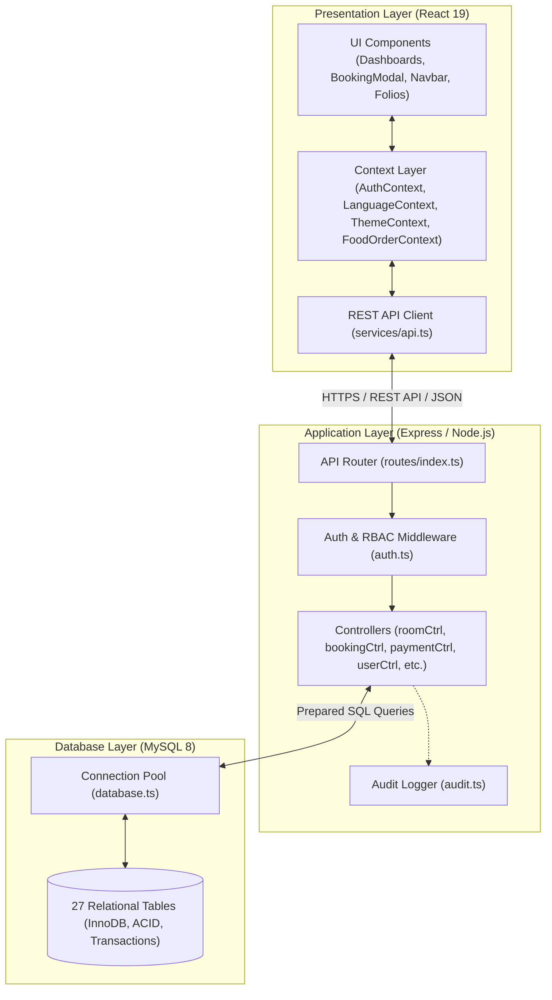

# SOFTWARE DESIGN DOCUMENT (SDD)
## Habesha Hotel Management System (SHMS)
**Document Version:** 1.0.0  
**Status:** Approved / Production  
**Date:** November 2026  

---

## 1. Introduction & Architectural Overview

The **Habesha Hotel Management System (SHMS)** is architected using a decoupled, layered client-server design pattern. It enforces strict separation between:
1. **Presentation Layer**: React 19 Single Page Application.
2. **Business Logic & Service Layer**: Express.js REST API with asynchronous controller handlers.
3. **Data Access & Storage Layer**: MySQL 8.0 relational database with connection pooling.

---

## 2. Component Design & Decomposition

### 2.1 Frontend Component Hierarchy
- **`App.tsx`**: Central application coordinator. Evaluates current authentication state and active view. Selects between the public website layout (`PublicWebsite`) or full-screen management dashboards.
- **`Navbar.tsx`**: Sticky luxury header featuring branding, navigation links, direct reservation CTA, notification drawer, language switcher (EN / አማርኛ), and role-based dashboard shortcuts.
- **`DashboardLayout.tsx`**: Shared enterprise dashboard wrapper providing collapsible sidebar navigation, user profile status, notification center, and prominent Light/Dark mode toggle.
- **`BookingModal.tsx`**: 4-step progressive disclosure modal:
  1. *Dates & Stay*: Check-in, check-out date selection, and guest count.
  2. *Choose Room*: Room type selection with real-time nightly pricing.
  3. *Food & Extras*: Add-on selection (Kitfo, Doro Wat, Shiro, Spa, Chauffeur).
  4. *Guest & Pay*: Identification capture and payment method selection.

### 2.2 Backend Module Decomposition
- **`authController.ts`**: Handles user login, registration, JWT token generation, password resets, and session validation (`GET /auth/me`).
- **`roomController.ts`**: Room type querying, room status updates, and dynamic temporal availability search.
- **`bookingController.ts`**: ACID-transactional booking creation, front-desk check-in, checkout turnover, and cancellations.
- **`paymentController.ts`**: Payment recording, invoice generation, itemized bill line item computation, and folio lookup.
- **`housekeepingController.ts`**: Cleaning turnover task scheduling, status transitions, and room cleanliness board.
- **`maintenanceController.ts`**: Defect ticketing, repair cost tracking, and room restoration.
- **`reportController.ts`**: Executive KPI calculation (ADR, RevPAR, Occupancy Rate), revenue trends, and CSV data export.
- **`userController.ts`**: User CRUD, staff directory, department hierarchy, and account status management.
- **`settingsController.ts`**: Global hotel settings, notification polling, and immutable audit log filtering.

---

## 3. Data Design & Transaction Management

### 3.1 Relational Schema Organization
The 27 database tables are categorized into 5 logical clusters:
1. **Identity & Access Control**: `roles`, `permissions`, `role_permissions`, `users`, `departments`, `employees`.
2. **Inventory & Rooms**: `room_types`, `rooms`, `amenities`, `room_amenities`.
3. **Reservations & Customers**: `customers`, `bookings`, `booking_rooms`, `booking_guests`, `hotel_services`, `service_orders`.
4. **Billing & Financials**: `invoices`, `invoice_items`, `payments`, `expenses`.
5. **Operations & Governance**: `housekeeping_tasks`, `maintenance_requests`, `reviews`, `complaints`, `notifications`, `audit_logs`, `hotel_settings`.

### 3.2 Transaction Management & Rollback
Multi-table mutations are wrapped in database transactions using `conn.beginTransaction()`, `conn.commit()`, and `conn.rollback()`:
- **Booking Creation**: Atomically inserts the customer record, booking record, invoice folio, and itemized invoice lines. If any step fails, the entire transaction is rolled back, preventing orphaned bookings or unbilled stays.
- **Checkout Turnover**: Atomically marks the booking `checked_out`, sets room status to `dirty`, and inserts a high-priority housekeeping task.

---

## 4. User Interface Architecture & Theme Scoping

### 4.1 Theme Isolation Architecture
To guarantee that switching between Light Mode and Dark Mode inside the dashboard never alters the public website:
- Light mode styling is scoped exclusively under the CSS selector `.dashboard-scope.theme-light`.
- The public website container never carries `.dashboard-scope`, preserving the luxury dark design at all times.
- When entering any dashboard via login or role selection, the system automatically initializes the dashboard in Light Mode by default.
- Users can switch between Light and Dark mode using the clearly visible toggle button in the dashboard topbar.

