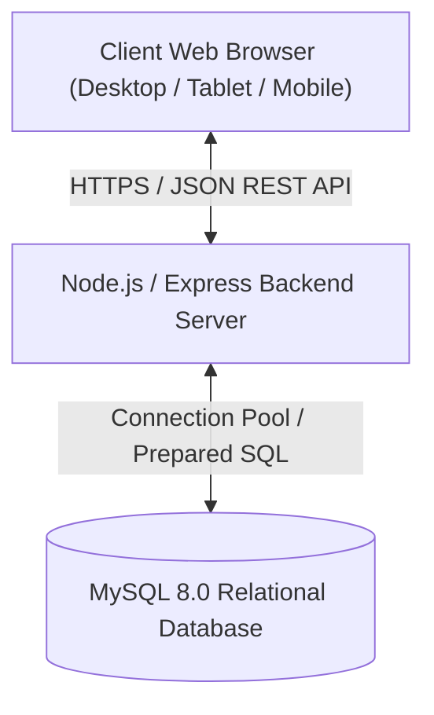

# SOFTWARE REQUIREMENTS SPECIFICATION (SRS)
## Habesha Hotel Management System (SHMS)
**Document Version:** 1.0.0  
**Status:** Approved / Production  
**Date:** November 2026  

---

## 1. Introduction

### 1.1 Purpose
This Software Requirements Specification (SRS) document details the complete functional, non-functional, interface, and operational requirements for the **Habesha Hotel Management System (SHMS)**. It is intended for software engineers, university evaluators, hotel operations management, and maintenance teams.

### 1.2 Document Scope
This document covers:
- Public customer reservation and dining portal.
- Front-desk operations (check-in, check-out, room status grid).
- Housekeeping room turnover and task scheduling.
- Engineering maintenance defect reporting and resolution.
- Accounting, itemized folios, expense ledgers, and payments.
- Management supervision, occupancy metrics, and guest complaint recovery.
- Super Administrator governance, RBAC permissions, and immutable audit logs.

### 1.3 Definitions, Acronyms, and Abbreviations
- **SHMS**: Smart Hotel Management System.
- **RBAC**: Role-Based Access Control.
- **JWT**: JSON Web Token.
- **ETB**: Ethiopian Birr (national currency).
- **Folio**: Itemized master bill of charges incurred by a guest during their stay.
- **ADR**: Average Daily Rate (Total Room Revenue / Number of Sold Rooms).
- **RevPAR**: Revenue Per Available Room (Total Room Revenue / Total Available Rooms).

---

## 2. Overall Description

### 2.1 Product Perspective
The Habesha Hotel Management System is a self-contained, three-tier web application operating with an asynchronous RESTful backend and a reactive single-page frontend. It interfaces with a centralized MySQL relational database engine.

### 2.2 Product Functions
- **Public Booking Engine**: Date range availability search, room type selection, food/amenity add-ons, guest identity capture, and automated voucher generation.
- **Front-Desk Grid**: Visual 18-room multi-floor matrix, walk-in registration, check-in validation, and checkout turnover triggering.
- **Housekeeping Pipeline**: Urgency-ranked room turnover queue, sanitization tracking, and defect reporting.
- **Maintenance Work Orders**: Defect logging, technician assignments, repair cost logging, and operational room restoration.
- **Folio Accounting**: Tax calculation (12% standard hotel hospitality tax), multi-channel payment reconciliation (Telebirr, CBE Birr, Cash, Card), operational expense tracking, and financial summary reporting.
- **System Governance**: Multi-branch management, RBAC permission matrix, user account lifecycle, and forensic audit trail logging.

### 2.3 User Classes and Characteristics
1. **Hotel Guest**: Online visitor seeking room booking, food ordering, and invoice retrieval. Minimal technical familiarity required.
2. **Receptionist**: Front-desk operator managing high-volume arrivals, departures, walk-in reservations, and keycard handovers.
3. **Housekeeper**: Floor staff tracking clean/dirty states and reporting room maintenance defects.
4. **Maintenance Technician**: Engineering specialist inspecting broken fixtures, logging repair costs, and repairing rooms.
5. **Accountant**: Financial officer reconciling payments, logging expenses, auditing invoices, and exporting financial reports.
6. **Hotel Manager**: Operations lead monitoring daily hotel pulse, occupancy trends, staff tasks, and resolving guest complaints.
7. **Administrator**: System administrator configuring hotel pricing, room inventory, employee credentials, and global hotel settings.
8. **Super Administrator**: Platform owner managing multiple hotel branches, granular role permissions, and immutable security audit logs.

### 2.4 Operating Environment
- **Server**: Node.js v20+ on Linux (Ubuntu 22.04 LTS) or Windows Server; MySQL 8.0+.
- **Client**: Any modern web browser with JavaScript enabled (Chrome, Edge, Firefox, Safari).

---

## 3. Specific Requirements

### 3.1 External Interface Requirements

#### 3.1.1 User Interfaces
- Responsive web layout adapting to mobile viewports (min 320px) up to 4K displays.
- Visual theme toggle (Light Mode vs. Dark Mode) with Light Mode active by default on dashboard login.
- Multilingual interface supporting full instantaneous switching between English and Amharic (አማርኛ).

#### 3.1.2 Software Interfaces
- **Database Connection**: `mysql2/promise` connection pool on port 3306.
- **RESTful API**: Standardized JSON responses with HTTP status codes (200, 201, 400, 401, 403, 404, 500).

### 3.2 Functional Requirements Matrix

| Req ID | Module | Description | Inputs | Expected Output |
|---|---|---|---|---|
| **REQ-01** | Auth | User Authentication | Email, Password | Signed JWT token, user profile object |
| **REQ-02** | Rooms | Search Availability | Check-in date, Check-out date, Guests | List of available, non-conflicting rooms |
| **REQ-03** | Booking | Create Online Reservation | Dates, Room type, Add-ons, Guest details | Created booking (`AG-YYYY-XXXX`) and invoice (`INV-YYYY-XXXX`) |
| **REQ-04** | Front Desk | Guest Check-in | Booking ID | Booking `checked_in`, Room `occupied`, Audit log written |
| **REQ-05** | Front Desk | Guest Check-out | Booking ID, Payment details | Booking `checked_out`, Room `dirty`, Housekeeping task pushed |
| **REQ-06** | Housekeeping | Room Cleaning Task | Task ID, Next status | Task `completed`, Room operational status `ready` |
| **REQ-07** | Maintenance | Report Engineering Fault | Room ID, Title, Severity | Room `under_repair`, Work order ticket generated |
| **REQ-08** | Accounting | Record Payment | Booking ID, Amount, Method | Payment reference generated, Invoice balance updated |
| **REQ-09** | Accounting | Log Operational Expense | Category, Title, Amount, Date | Expense record stored, Financial summary updated |
| **REQ-10** | Super Admin | Audit Log Inspection | Filters (Action, Role, Date, Search) | Filtered immutable audit log records with CSV export |

### 3.3 Non-Functional Requirements

- **Security**: Salted bcrypt password hashes (salt factor 10), 7-day expiration JWTs, parameterized prepared statements against SQL injection.
- **Performance**: Sub-150ms average API response time; sub-2s cold page bundle load.
- **Maintainability**: Strict TypeScript static typing (`tsc --noEmit`), decoupled modular controllers, and centralized error middleware.
- **Reliability**: ACID transaction guarantees with automated rollback upon multi-step booking or invoice failures.

